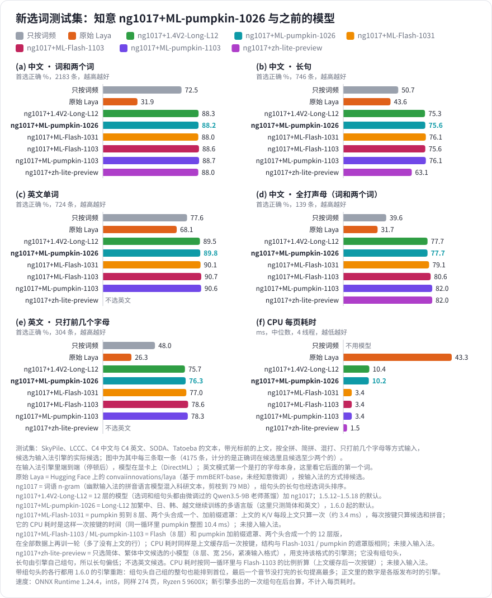
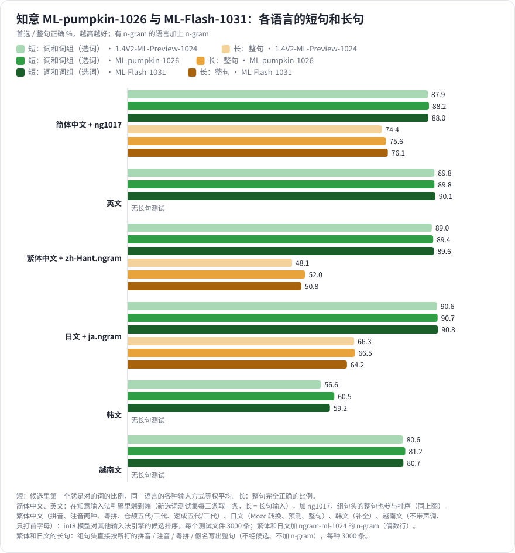
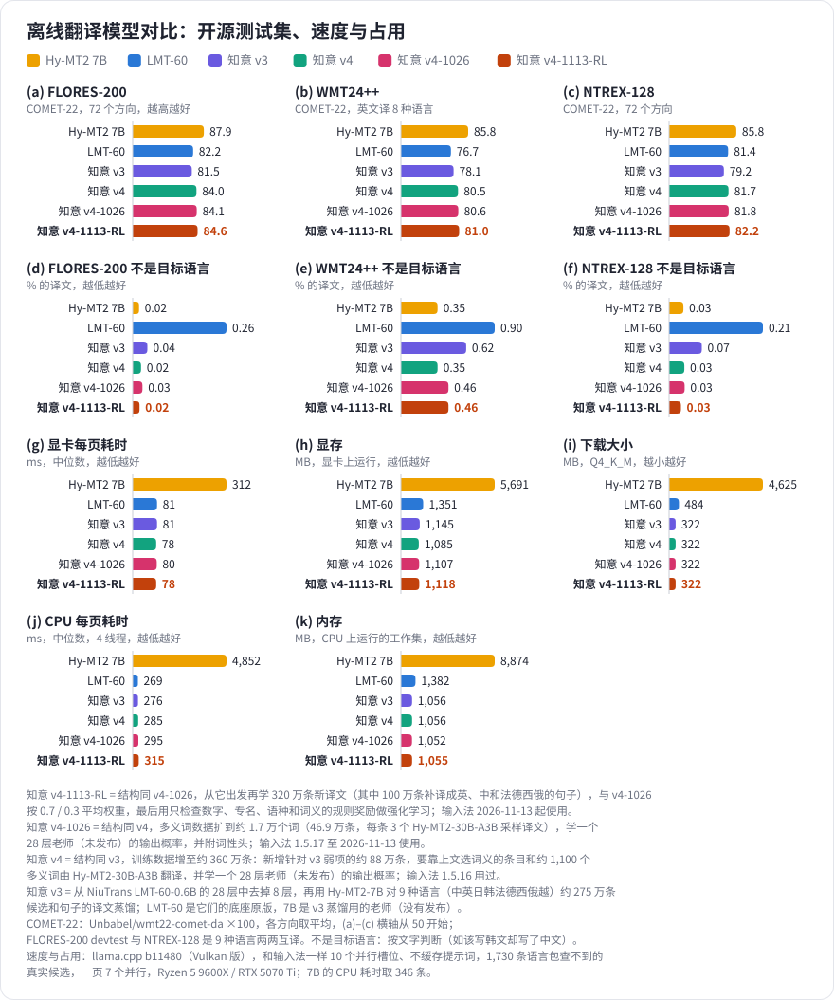
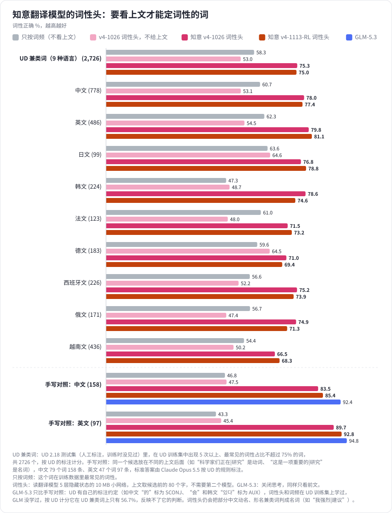

# 知意模型（Zhiyi Models）

[English](README_EN.md) | **中文**

[知意输入法](https://github.com/dd1000001000/zhiyi_ime)自己训练的模型：按光标前的文字给候选排序、把长拼音组成句子的选词模型，选词时一起打分的词语
n-gram，以及学习模式里翻译候选的离线翻译模型。模型文件在各个 [Release](https://github.com/dd1000001000/zhiyi_models/releases) 里，这里是说明和评测结果。
训练代码和训练、评测数据涉及第三方语料的版权，不公开；[中立选词测试集 v2](benchmarks/neutral-v2)、[v3](benchmarks/neutral-v3)、[v4](benchmarks/neutral-v4)、[v5](benchmarks/neutral-v5) 除外，供别人测试使用。

## 模型一览

| 模型 | 内容 | 知意输入法 | 下载 |
| --- | --- | --- | --- |
| zh-lite-preview | 简体、繁体中文选词（预览），8 层、宽 256，紧凑输入格式；大小和计算量约为 Flash 的三分之一 | 未接入（引擎还不支持它的输入格式） | [model-zh-lite-preview](https://github.com/dd1000001000/zhiyi_models/releases/tag/model-zh-lite-preview) |
| ML-pumpkin-1103 | 多语言选词和组句，12 层，可以缓存上文；没有上文时更准，另附 KV cache 单图和算子融合版 | 未接入 | [model-ml-pumpkin-1103](https://github.com/dd1000001000/zhiyi_models/releases/tag/model-ml-pumpkin-1103) |
| ML-Flash-1103 | 多语言选词和组句，8 层，可以缓存上文；没有上文时更准，另附 KV cache 单图和算子融合版 | 未接入 | [model-ml-flash-1103](https://github.com/dd1000001000/zhiyi_models/releases/tag/model-ml-flash-1103) |
| ML-Flash-1031 | 多语言选词和组句，8 层，可以缓存上文 | 未接入 | [model-ml-flash-1031](https://github.com/dd1000001000/zhiyi_models/releases/tag/model-ml-flash-1031) |
| ML-pumpkin-1026 | 多语言选词和组句（简体中文、英文、繁体中文、日文、韩文、越南文），12 层 | 1.6.0 起的默认模型 | [model-ml-pumpkin-1026](https://github.com/dd1000001000/zhiyi_models/releases/tag/model-ml-pumpkin-1026) |
| 1.4V2-ML-Preview-1024 | 多语言预览版（ML-pumpkin-1026 的上一版） | 未接入 | [model-ml-preview-1024](https://github.com/dd1000001000/zhiyi_models/releases/tag/model-ml-preview-1024) |
| 1.4V2-Long-L12 | 中英文选词和组句，12 层 | 1.5.12–1.5.18 | [model-zhen-long-l12](https://github.com/dd1000001000/zhiyi_models/releases/tag/model-zhen-long-l12) |
| 1.4V2-Long-L18 | 中英文选词和组句，18 层 | 1.5.9–1.5.11 | [model-zhen-long-l18](https://github.com/dd1000001000/zhiyi_models/releases/tag/model-zhen-long-l18) |
| ng1017 | 简体中文词语 n-gram | 1.5.10 起 | [ngram-zh-1017](https://github.com/dd1000001000/zhiyi_models/releases/tag/ngram-zh-1017) |
| ngram-ml-1024 | 繁体中文、日文词语 n-gram | 不用 | [ngram-ml-1024](https://github.com/dd1000001000/zhiyi_models/releases/tag/ngram-ml-1024) |
| 离线翻译 v4-1026 | 9 种语言的候选翻译，带词性头 | 1.5.17 起 | [translator-v4-1026](https://github.com/dd1000001000/zhiyi_models/releases/tag/translator-v4-1026) |
| 离线翻译 v4 | 9 种语言的候选翻译 | 2026-10-24 至 10-26 | [translator-v4](https://github.com/dd1000001000/zhiyi_models/releases/tag/translator-v4) |
| 离线翻译 v3 | 9 种语言的候选翻译 | 2026-10-24 前 | [translator-v3](https://github.com/dd1000001000/zhiyi_models/releases/tag/translator-v3) |
| 离线翻译 v2 | 第 2 版，留作参考 | 不再使用 | [translator-v2](https://github.com/dd1000001000/zhiyi_models/releases/tag/translator-v2) |

- **选词模型**：`*-int8g.zip` 是 int8 ONNX，解压到知意输入法源码的 `models/laya/` 即可使用（[`scripts/fetch_model.py`](https://github.com/dd1000001000/zhiyi_ime/blob/main/scripts/fetch_model.py) 下载默认模型）；
  `*-safetensors.zip` 是不量化的权重，附 README（每种输入序列和前向计算）、测试向量和 candle 参考实现，供其他输入法使用。
- **词语 n-gram**：格式见知意输入法的 [`engine/src/laya/ngram.h`](https://github.com/dd1000001000/zhiyi_ime/blob/main/engine/src/laya/ngram.h)。
- **翻译模型**：`.gguf` 可以直接用 llama.cpp 加载；`*-safetensors.zip` 是 Hugging Face 格式（Qwen3ForCausalLM），模型卡写明了提示词格式。
  知意输入法在设置的“学习”页下载翻译模型（下载地址是 zhiyi_ime 的 [Release translator](https://github.com/dd1000001000/zhiyi_ime/releases/tag/translator)，那里还有 llama.cpp 运行库），不需要手动下载。

## 选词模型与新选词测试集

新做的选词测试集更接近实际打字：文本来自 SkyPile、LCCC 对话、C4 中英文、SODA 对话和 Tatoeba，带光标前的上文，按全拼、简拼、全拼和声母混打、英文只打前几个字母等方式输入，候选是输入法引擎的实际候选。1.5.9–1.5.11 的默认模型知意 1.4V2-Long-L18（[Release model-zhen-long-l18](https://github.com/dd1000001000/zhiyi_models/releases/tag/model-zhen-long-l18)，Apache-2.0）是 1.4V2 去掉 4 个滑窗注意力层（22 层 → 18 层），用微调过的 Qwen3.5-9B 老师模型（Apache-2.0）在约 170 万条这样的数据上蒸馏选词：候选放在上文之后，不再带提示词，候选只写一次，所以每页要算的词元少了约四成；组句头沿用 1.4V2 的结构，和编码器一起训练。在输入法引擎里端到端（停顿后），它比 1.4V2 的首选正确率高：中文词和两个词 86.2%（1.4V2 为 84.4%），长句 67.2%（66.2%），英文 90.2%（87.7%），全打声母 77.7%（69.8%），英文只打前几个字母 77.3%（71.4%）；CPU 上一页 14.6 ms，约为 1.4V2 的一半。旧测试集上的长句全拼 61.8%，末字只打声母 30.6%，前面简拼、后面全拼 16.5%，输入法实际候选 77.6%。

图中也列出原始 Laya（Hugging Face 上的 [convaiinnovations/laya](https://huggingface.co/convaiinnovations/laya)，基于 mmBERT-base，未经知意微调）作参照：直接用它给候选排序，首选正确率比只按词频还低（中文词和两个词 31.9%，长句 43.6%，英文 68.1%，全打声母 31.7%，英文只打前几个字母 26.3%），CPU 上一页 43.3 ms；知意各版模型的提升来自在输入法实际候选上的微调和蒸馏。

ng1017+1.4V2-Long-L18 在 1.4V2-Long-L18 上加了一个词语 n-gram（三元语言模型）：底座是[幽默输入法](https://github.com/Sraw/youmo-ime)的拼音语言模型（[libime](https://github.com/fcitx/libime) 的模型混入 FineWeb-2 和 Common Crawl 的口语网页），用幽默的工具再混入约 1 亿字的科研文本（[CSL](https://github.com/ydli-ai/CSL) 论文摘要，以及 SkyPile、C4、FineWeb-2 里的科技页面），按相对熵剪枝到二元、三元各 400 万条（79 MB）。选词时每个整句候选加上它给的 ln P（权重在开发集上调），没有上文时也用模型和 n-gram 选词；组句头组出的长句也经过选词头排序（以前组句的第一句直接放在首位）。在输入法引擎里端到端：中文词和两个词 86.2% → 87.6%，长句 67.2% → 74.5%，英文、全打声母和英文只打前几个字母不变；旧测试集的长句全拼 61.8% → 69.0%，末字只打声母 30.6% → 36.6%，前面简拼、后面全拼 16.5% → 21.9%。代价：CPU 上没有上文的页要多算一次模型（中位数约 2 → 11 ms），长句页多一次选词（约 +10 ms），n-gram 文件 79 MB（映射，不读进内存）。

知意 1.4V2-Long-L12（[Release model-zhen-long-l12](https://github.com/dd1000001000/zhiyi_models/releases/tag/model-zhen-long-l12)，Apache-2.0，含 safetensors 版）是 1.5.12–1.5.18 的默认模型，1.4V2 只保留 12 层编码器（22 层 → 12 层）的新模型。选词用微调过的 Qwen3.5-9B 老师在约 377 万条数据上蒸馏：1.4V2-Long-L18 的约 170 万条之外，新加约 172 万条 SkyPile、LCCC、C4、SODA 的文本，和约 35 万条 [FineWeb](https://huggingface.co/datasets/HuggingFaceFW/fineweb)、[FineWeb-2](https://huggingface.co/datasets/HuggingFaceFW/fineweb-2)（ODC-By 1.0）的近年网页，中英文约 3:1。组句头由另一个微调过、按字写出所打汉字的 Qwen3.5-9B 老师蒸馏，用了约 431 万条组句数据，其中 220 万条带老师打分。加上 ng1017 后在输入法引擎里端到端，它和 ng1017+1.4V2-Long-L18 打平：中文词和两个词 87.7%（87.6%），长句 74.9%（74.5%），英文 89.5%（90.2%），全打声母 76.3%（77.7%），英文只打前几个字母 75.7%（77.3%），差别都在抽样误差之内；CPU 上一页 10.4 ms（14.7 ms），快约三成，模型文件 84 MB（96 MB）。1.5.12–1.5.18 输入法带的是 ng1017+1.4V2-Long-L12。

多语言预览版 [知意 1.4V2-ML-Preview-1024](https://github.com/dd1000001000/zhiyi_models/releases/tag/model-ml-preview-1024)在 Long-L12 上加了繁体中文、日文、韩文、越南文的选词和繁体、日文的组句；第二版 [知意 ML-pumpkin-1026](https://github.com/dd1000001000/zhiyi_models/releases/tag/model-ml-pumpkin-1026) 补了繁体组句和韩文的数据，是现在输入法的默认模型（用它的简体和英文）；8 层的 [知意 ML-Flash-1031](https://github.com/dd1000001000/zhiyi_models/releases/tag/model-ml-flash-1031) 可以缓存上文，每次按键的 CPU 耗时约为 pumpkin 的三分之一（未接入输入法）。繁体和日文的词语 n-gram 见 [ngram-ml-1024](https://github.com/dd1000001000/zhiyi_models/releases/tag/ngram-ml-1024)：

## 离线翻译模型

学习模式里语言包查不到的候选由本机的翻译模型翻译，现在用的是知意 v4-1026（1.5.17 起，之前装了旧版本的在设置“学习”页更新）。v3 从 [LMT-60-0.6B](https://huggingface.co/NiuTrans/LMT-60-0.6B) 的 28 层中去掉 8 层，用腾讯 [Hy-MT2-7B](https://huggingface.co/tencent/Hy-MT2-7B) 对约 275 万条输入法候选和句子（中、英、日、韩、法、德、西、俄、越 9 种语言，带光标前的上文）的译文蒸馏而来。v4 在 [Release translator-v4](https://github.com/dd1000001000/zhiyi_models/releases/tag/translator-v4) 发布，结构和 v3 相同，训练数据增至约 360 万条，新增针对 v3 弱项的约 88 万条（要靠上文选词义的条目由 [Hy-MT2-30B-A3B](https://huggingface.co/tencent/Hy-MT2-30B-A3B) 翻译）和约 1,100 个多义词，并学一个 28 层老师的输出概率。在三个开源测试集上，v4 的 COMET-22 比 v3 高约 2.4–2.5 分（FLORES-200 81.5 → 84.0，WMT24++ 78.1 → 80.5，NTREX-128 79.2 → 81.7），三个都超过 LMT-60 原版（82.2、76.7、81.4）；输出不是目标语言的比例也更低（WMT24++ 0.62% → 0.35%，另外两个都在 0.1% 以下）。两者都是下载约 0.32 GB，显卡上一页约 70 毫秒、CPU 上一页约 0.28 秒，显存和内存都约 1.1 GB。

[知意 v4-1026](https://github.com/dd1000001000/zhiyi_models/releases/tag/translator-v4-1026) 另带一个 10 MB 的词性头：读翻译模型自己的隐藏状态，按候选前面的上文判断候选的词性，翻成哪种语言都能用，不需要第二个模型，接法见它的 safetensors 包里的 README。1.5.17 起输入法用它在模型译文前标词性（如 `adv./adj. fast`），由打了补丁的 llama-server 在翻译的同时算出（[scripts/llama_server_pos](https://github.com/dd1000001000/zhiyi_ime/tree/main/scripts/llama_server_pos)）。在要看上文才能定词性的词上：

## 中立选词测试集 v5：困难集

5,220 行难题：两个词或 6–20 个字的长片段，一半以上是简拼、混拼或末字只打一部分，每行 7–20 个候选，三分之二的行上文很短或没有；只保留出候选的引擎自己排错了的行（挑题不用任何神经网络模型），候选来源和 v3 相同。说明见 [benchmarks/neutral-v5](benchmarks/neutral-v5)，数据在 [Release neutral-v5](https://github.com/dd1000001000/zhiyi_models/releases/tag/neutral-v5)。

## 中立选词测试集 v4：聊天

25,243 行（17,072 行计分）聊天选词题：文本是公开对话测试集 LCCC-base 的 test 部分，上文是对话里前面几句话；候选来源和 v3 相同。LCCC 的作者声明其数据仅限科研用途，所以 v4 只能用于研究和评测。说明见 [benchmarks/neutral-v4](benchmarks/neutral-v4)，数据在 [Release neutral-v4](https://github.com/dd1000001000/zhiyi_models/releases/tag/neutral-v4)。

## 中立选词测试集 v3

16,656 行简体中文拼音选词题：文本是 2026 年 10 月的中文网页，按词打字；每行的候选来自八个开源输入法引擎（知意、Rime 雾凇拼音、Rime 朙月拼音、幽默、libpinyin、fcitx5 libime、青简、水杉）中随机的一个，取它的前 3–20 个，并注明输入法和版本；附打分脚本，可以按引擎分组看结果。说明、字段和用法见 [benchmarks/neutral-v3](benchmarks/neutral-v3)，数据在 [Release neutral-v3](https://github.com/dd1000001000/zhiyi_models/releases/tag/neutral-v3)。

## 中立选词测试集 v2

7,108 行简体中文拼音选词题：文本是 2026 年的中文网页，按词打字，候选来自知意输入法引擎；附打分脚本，任何能给候选排序的模型或输入法都可以测。说明、字段和用法见 [benchmarks/neutral-v2](benchmarks/neutral-v2)，数据在 [Release neutral-v2](https://github.com/dd1000001000/zhiyi_models/releases/tag/neutral-v2)。

## 许可

知意自己训练的模型（各版选词模型、离线翻译模型 v2、v3、v4、v4-1026、ngram-ml-1024）的权重按 [Apache-2.0](LICENSE) 发布
（2026-10-20 前为 GPL-3.0-only）；词语 n-gram ng1017 随其底座按 [LGPL-2.1-or-later](LICENSE-LGPL-2.1.txt) 发布；
选词模型 safetensors 压缩包里的 `candle_ref/` 参考代码和知意输入法一样按 GPL-3.0-only 发布。上游部分保持各自的许可，
每个压缩包附带对应的许可证。中立选词测试集 v2–v5 的数据库按 ODC-By 1.0 发布（[v2](benchmarks/neutral-v2/LICENSE-DATA.txt)、[v3](benchmarks/neutral-v3/LICENSE-DATA.txt)、[v4](benchmarks/neutral-v4/LICENSE-DATA.txt)、[v5](benchmarks/neutral-v5/LICENSE-DATA.txt)），网页原文的版权归原作者，v4 的对话文本来自 LCCC（MIT，作者声明仅限科研用途，见 [LICENSE-LCCC.txt](benchmarks/neutral-v4/LICENSE-LCCC.txt)），v3–v5 的候选来自各输入法引擎、引擎和词库保持各自的许可，打分脚本按 Apache-2.0 发布。

## 致谢

- [Laya](https://huggingface.co/convaiinnovations/laya)：选词模型的结构与蒸馏用的老师模型（Apache-2.0）
- [mmBERT](https://huggingface.co/jhu-clsp/mmBERT-small)：选词模型的编码器和分词器 mmBERT-small（MIT）
- [Qwen3.5-9B](https://huggingface.co/Qwen/Qwen3.5-9B)（通义千问）：选词和组句头蒸馏用的老师模型，经 LoRA 微调（Apache-2.0），只用了它们的打分
- [LMT-60](https://huggingface.co/NiuTrans/LMT-60-0.6B)（NiuTrans）：离线翻译模型的底座（Apache-2.0）
- [Hy-MT2](https://huggingface.co/tencent/Hy-MT2-7B)（腾讯混元）：离线翻译蒸馏用的老师模型（7B，v4 起还有 [30B-A3B](https://huggingface.co/tencent/Hy-MT2-30B-A3B)）（Apache-2.0）
- [幽默输入法](https://github.com/Sraw/youmo-ime)：ng1017 的底座（它的拼音语言模型）和 n-gram 混合工具（LGPL-2.1-or-later）；其底座来自 [libime](https://github.com/fcitx/libime)（LGPL-2.1-or-later），混入的网页来自 [FineWeb-2](https://huggingface.co/datasets/HuggingFaceFW/fineweb-2)（ODC-By）和 [Common Crawl](https://commoncrawl.org)
- [CSL](https://github.com/ydli-ai/CSL)（中文科学文献数据集，Apache-2.0）：ng1017 混入的科研文本
- [jieba](https://github.com/fxsjy/jieba)（MIT）、[OpenCC](https://github.com/BYVoid/OpenCC)、[SudachiPy](https://github.com/WorksApplications/sudachi.rs)：ngram-ml-1024 的词表
- [SkyPile-150B](https://huggingface.co/datasets/Skywork/SkyPile-150B)（昆仑万维天工 Skywork，Skywork Community License）、[LCCC](https://github.com/thu-coai/CDial-GPT)（MIT）、[C4](https://huggingface.co/datasets/allenai/c4)（ODC-BY）、[SODA](https://huggingface.co/datasets/allenai/soda)（CC BY 4.0）、[Tatoeba](https://tatoeba.org)（CC BY 2.0 FR）：选词、组句和翻译训练数据的文本
- [FineWeb](https://huggingface.co/datasets/HuggingFaceFW/fineweb) 与 [FineWeb-2](https://huggingface.co/datasets/HuggingFaceFW/fineweb-2)（ODC-By 1.0）：近年网页，以及繁体中文、粤语、日文、韩文、越南文的文本
- [粤语维基百科](https://zh-yue.wikipedia.org)（CC BY-SA 4.0）：ML-pumpkin-1026 粤拼组句的部分文本
- librime 与 rime 各方案、fcitx5-table-extra、libchewing、Mozc、pypinyin：多语言模型训练数据的候选和读音（只用来生成训练数据，不在模型文件里）
