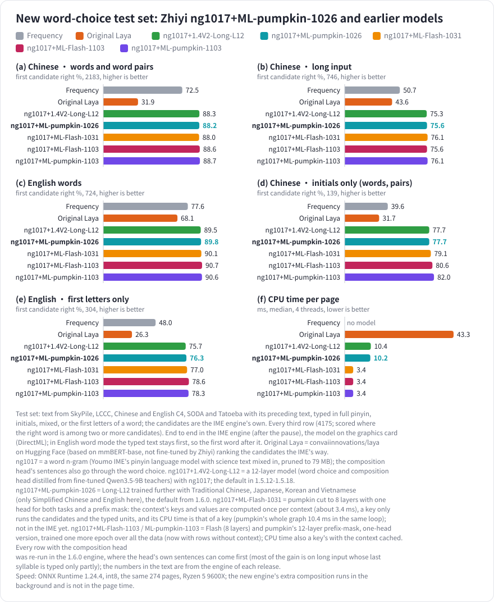
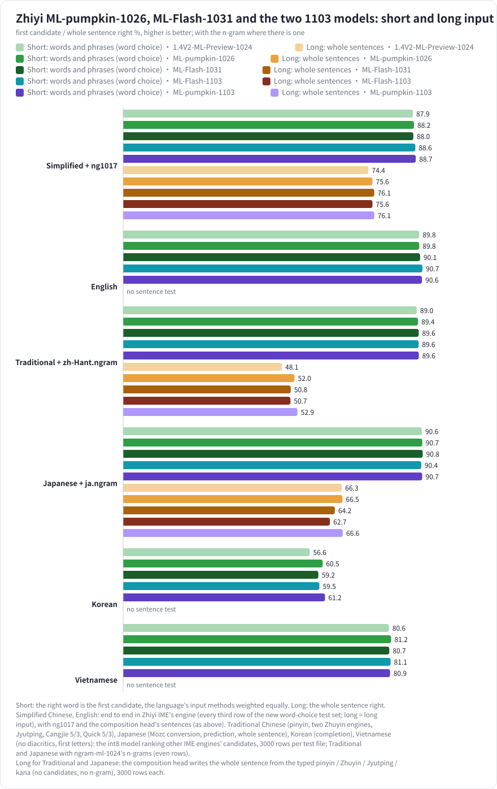
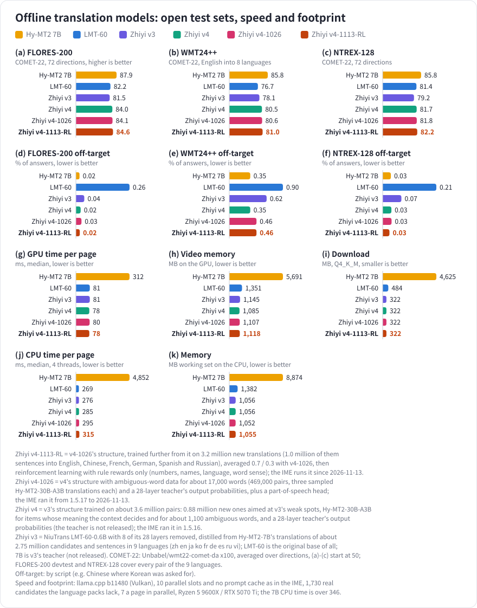
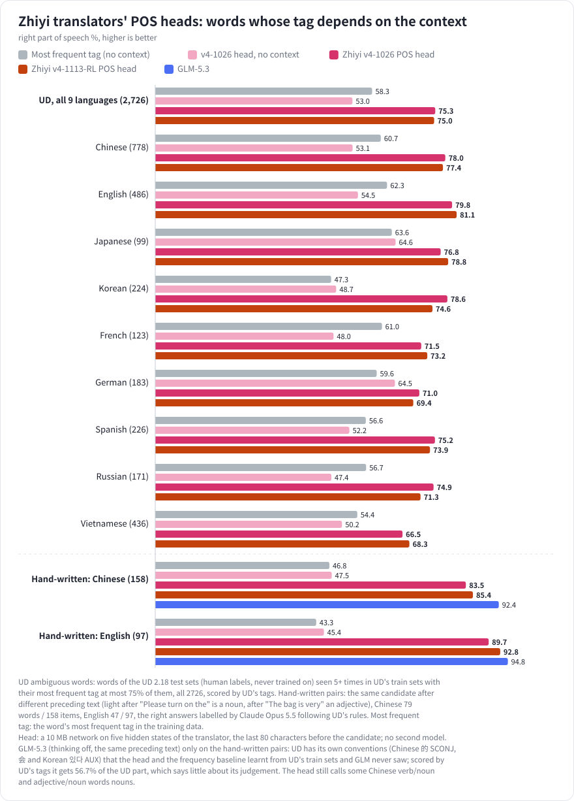

# Zhiyi Models (知意模型)

**English** | [中文](README.md)

The models trained for [Zhiyi IME](https://github.com/dd1000001000/zhiyi_ime): word-choice models that rank candidates by the text before the caret and
compose long pinyin into sentences, the word n-grams scored next to them, and the offline translation models of learning
mode. The files are in the [releases](https://github.com/dd1000001000/zhiyi_models/releases); this repository has their descriptions and results. The training
code and the training and test data are not published (copyright of third-party text), except the
neutral word-choice test sets [v2](benchmarks/neutral-v2), [v3](benchmarks/neutral-v3), [v4](benchmarks/neutral-v4) and
[v5](benchmarks/neutral-v5), released for others to test on.

## Models

| Model | What it does | In Zhiyi IME | Download |
| --- | --- | --- | --- |
| zh-lite-preview | Simplified and Traditional Chinese word choice (preview), 8 layers of width 256, a compact input sequence; about a third of Flash's size and compute | Not yet (the engine does not build its input) | [model-zh-lite-preview](https://github.com/dd1000001000/zhiyi_models/releases/tag/model-zh-lite-preview) |
| ML-pumpkin-1103 | Multilingual word choice and composition, 12 layers, caches the context; better without context, with a one-graph KV-cache and a fused-operator version | Not yet | [model-ml-pumpkin-1103](https://github.com/dd1000001000/zhiyi_models/releases/tag/model-ml-pumpkin-1103) |
| ML-Flash-1103 | Multilingual word choice and composition, 8 layers, caches the context; better without context, with a one-graph KV-cache and a fused-operator version | Not yet | [model-ml-flash-1103](https://github.com/dd1000001000/zhiyi_models/releases/tag/model-ml-flash-1103) |
| ML-Flash-1031 | Multilingual word choice and composition, 8 layers, caches the context | Not yet | [model-ml-flash-1031](https://github.com/dd1000001000/zhiyi_models/releases/tag/model-ml-flash-1031) |
| ML-pumpkin-1026 | Multilingual word choice and composition (Simplified Chinese, English, Traditional Chinese, Japanese, Korean, Vietnamese), 12 layers | Default from 1.6.0 | [model-ml-pumpkin-1026](https://github.com/dd1000001000/zhiyi_models/releases/tag/model-ml-pumpkin-1026) |
| 1.4V2-ML-Preview-1024 | Multilingual preview (the round before ML-pumpkin-1026) | No | [model-ml-preview-1024](https://github.com/dd1000001000/zhiyi_models/releases/tag/model-ml-preview-1024) |
| 1.4V2-Long-L12 | Chinese and English word choice and composition, 12 layers | 1.5.12-1.5.18 | [model-zhen-long-l12](https://github.com/dd1000001000/zhiyi_models/releases/tag/model-zhen-long-l12) |
| 1.4V2-Long-L18 | Chinese and English word choice and composition, 18 layers | 1.5.9-1.5.11 | [model-zhen-long-l18](https://github.com/dd1000001000/zhiyi_models/releases/tag/model-zhen-long-l18) |
| ng1017 | Simplified Chinese word n-gram | From 1.5.10 | [ngram-zh-1017](https://github.com/dd1000001000/zhiyi_models/releases/tag/ngram-zh-1017) |
| ngram-ml-1024 | Traditional Chinese and Japanese word n-grams | No | [ngram-ml-1024](https://github.com/dd1000001000/zhiyi_models/releases/tag/ngram-ml-1024) |
| Offline translation v4-1026 | Candidate translation in 9 languages, with a part-of-speech head | From 1.5.17 | [translator-v4-1026](https://github.com/dd1000001000/zhiyi_models/releases/tag/translator-v4-1026) |
| Offline translation v4 | Candidate translation in 9 languages | 2026-10-24 to 10-26 | [translator-v4](https://github.com/dd1000001000/zhiyi_models/releases/tag/translator-v4) |
| Offline translation v3 | Candidate translation in 9 languages | Until 2026-10-24 | [translator-v3](https://github.com/dd1000001000/zhiyi_models/releases/tag/translator-v3) |
| Offline translation v2 | Version 2, kept for reference | No longer | [translator-v2](https://github.com/dd1000001000/zhiyi_models/releases/tag/translator-v2) |

- **Word-choice models**: `*-int8g.zip` is int8 ONNX; unzip it into `models/laya/` of the Zhiyi IME source ([`scripts/fetch_model.py`](https://github.com/dd1000001000/zhiyi_ime/blob/main/scripts/fetch_model.py) downloads the default model).
  `*-safetensors.zip` holds the unquantized weights with a README (every input sequence and the forward pass), test vectors and a candle reference, for other IMEs.
- **Word n-grams**: the format is Zhiyi IME's [`engine/src/laya/ngram.h`](https://github.com/dd1000001000/zhiyi_ime/blob/main/engine/src/laya/ngram.h).
- **Translation models**: the `.gguf` files load in llama.cpp as they are; `*-safetensors.zip` is Hugging Face format (Qwen3ForCausalLM) with a model card giving the prompt format.
  Zhiyi IME downloads its translation model on the Learning page of Settings (from zhiyi_ime's [translator release](https://github.com/dd1000001000/zhiyi_ime/releases/tag/translator), which also has the llama.cpp runtime); no manual download is needed.

## Word-choice models and the new test set

The new word-choice test set is closer to real typing: text from SkyPile, LCCC dialogues, Chinese and English C4, SODA dialogues and Tatoeba, with its preceding text, typed in full pinyin, initials, full pinyin mixed with initials, or the first letters of an English word; the candidates are the IME engine's own. The default model of 1.5.9-1.5.11, Zhiyi 1.4V2-Long-L18 ([release model-zhen-long-l18](https://github.com/dd1000001000/zhiyi_models/releases/tag/model-zhen-long-l18), Apache-2.0), is 1.4V2 with 4 of its sliding-window attention layers removed (22 → 18), its word choice distilled on about 1.7M such rows from a fine-tuned Qwen3.5-9B teacher (Apache-2.0): the candidates come after the context, with no prompt, each written once, so a page has about 40% fewer tokens to compute; the composition head is 1.4V2's, trained on with the encoder. End to end in the IME engine (after the pause) it puts the right word first more often than 1.4V2: Chinese words and word pairs 86.2% (1.4V2: 84.4%), long input 67.2% (66.2%), English 90.2% (87.7%), initials only 77.7% (69.8%), English first letters only 77.3% (71.4%); 14.6 ms a page on the CPU, about half of 1.4V2's. On the older long-input test set: full pinyin 61.8%, last syllables as initials 30.6%, abbreviated then full 16.5%, and 77.6% on the IME's real candidates.

For reference the chart also has the original Laya ([convaiinnovations/laya](https://huggingface.co/convaiinnovations/laya) on Hugging Face, based on mmBERT-base, not fine-tuned by Zhiyi): ranking the candidates with it as it is puts the right word first less often than frequency alone (Chinese words and word pairs 31.9%, long input 43.6%, English 68.1%, initials only 31.7%, English first letters only 26.3%), at 43.3 ms a page on the CPU; what the Zhiyi models gain comes from fine-tuning and distillation on the IME's real candidates.

ng1017+1.4V2-Long-L18 adds a word n-gram (a trigram language model) to 1.4V2-Long-L18. Its base is the pinyin language model of [Youmo IME](https://github.com/Sraw/youmo-ime) ([libime](https://github.com/fcitx/libime)'s model mixed with conversational pages of FineWeb-2 and Common Crawl); with Youmo's tool about 100 million characters of science text were mixed in ([CSL](https://github.com/ydli-ai/CSL) paper abstracts and the science and technology pages of SkyPile, C4 and FineWeb-2), and it was pruned by relative entropy to 4 million bigrams and 4 million trigrams (79 MB). Each whole-input candidate's score gains the n-gram's ln P (its weight tuned on the dev set), and the word choice now runs with nothing before the caret too; the sentences the composition head writes also go through the word choice (before, its first sentence simply went first). End to end in the IME engine: Chinese words and word pairs 86.2% → 87.6%, long input 67.2% → 74.5%, English, initials only and English first letters unchanged; on the older long-input test set, full pinyin 61.8% → 69.0%, the last syllable as its initial 30.6% → 36.6%, initials then full pinyin 16.5% → 21.9%. The cost: on the CPU a page with nothing before the caret now runs the model (median about 2 → 11 ms), a long-input page runs the word choice once more (about +10 ms), and the n-gram file is 79 MB (mapped, not read into memory).

Zhiyi 1.4V2-Long-L12 ([release model-zhen-long-l12](https://github.com/dd1000001000/zhiyi_models/releases/tag/model-zhen-long-l12), Apache-2.0, with a safetensors version), the default model in 1.5.12-1.5.18, is a new model that keeps 12 of 1.4V2's 22 encoder layers. Its word choice is distilled from a fine-tuned Qwen3.5-9B teacher on about 3.77M rows: besides 1.4V2-Long-L18's 1.7M, about 1.72M more of SkyPile, LCCC, C4 and SODA text and about 0.35M rows of recent web pages from [FineWeb](https://huggingface.co/datasets/HuggingFaceFW/fineweb) and [FineWeb-2](https://huggingface.co/datasets/HuggingFaceFW/fineweb-2) (ODC-By 1.0), Chinese and English about 3:1. Its composition head is distilled from a second fine-tuned Qwen3.5-9B teacher that writes the typed characters, on about 4.31M composition rows, 2.2M of them scored by the teacher. With ng1017, end to end in the IME engine, it ties ng1017+1.4V2-Long-L18: Chinese words and word pairs 87.7% (87.6%), long input 74.9% (74.5%), English 89.5% (90.2%), initials only 76.3% (77.7%), English first letters only 75.7% (77.3%), all within sampling error; 10.4 ms a page on the CPU (14.7 ms), about 30% faster, and an 84 MB model file (96 MB). Zhiyi IME shipped ng1017+1.4V2-Long-L12 in 1.5.12-1.5.18.

The multilingual preview [Zhiyi 1.4V2-ML-Preview-1024](https://github.com/dd1000001000/zhiyi_models/releases/tag/model-ml-preview-1024) adds word choice for Traditional Chinese, Japanese, Korean and Vietnamese and composition for Traditional Chinese and Japanese to Long-L12; its second round [Zhiyi ML-pumpkin-1026](https://github.com/dd1000001000/zhiyi_models/releases/tag/model-ml-pumpkin-1026) adds more Traditional composition and Korean data and is now the IME's default model (its Simplified Chinese and English); the 8-layer [Zhiyi ML-Flash-1031](https://github.com/dd1000001000/zhiyi_models/releases/tag/model-ml-flash-1031) caches the context and takes about a third of pumpkin's CPU time per key (not in the IME yet). Word n-grams for Traditional Chinese and Japanese are in [ngram-ml-1024](https://github.com/dd1000001000/zhiyi_models/releases/tag/ngram-ml-1024):

## Offline translation model

Candidates the learning-mode language packs lack are translated by a model on your computer, now Zhiyi v4-1026 (from 1.5.17; with an older version installed, update it on the Learning page in Settings). v3 is [LMT-60-0.6B](https://huggingface.co/NiuTrans/LMT-60-0.6B) with 8 of its 28 layers removed, distilled from Tencent [Hy-MT2-7B](https://huggingface.co/tencent/Hy-MT2-7B)'s translations of about 2.75 million IME candidates and sentences (in 9 languages: Chinese, English, Japanese, Korean, French, German, Spanish, Russian and Vietnamese, with the text before the caret). v4, released in [release translator-v4](https://github.com/dd1000001000/zhiyi_models/releases/tag/translator-v4), has the same structure, trained on about 3.6 million pairs, adding about 0.88 million aimed at v3's weak spots (items whose meaning the context decides translated by [Hy-MT2-30B-A3B](https://huggingface.co/tencent/Hy-MT2-30B-A3B)) and about 1,100 ambiguous words, and learning a 28-layer teacher's output probabilities. On three open test sets v4's COMET-22 is about 2.4-2.5 points above v3 (FLORES-200 81.5 → 84.0, WMT24++ 78.1 → 80.5, NTREX-128 79.2 → 81.7) and above the original LMT-60 on all three (82.2, 76.7, 81.4); fewer answers are not in the target language (WMT24++ 0.62% → 0.35%, the other two under 0.1%). Both are a download of about 0.32 GB, take about 70 ms a page on the graphics card and about 0.28 s on the CPU, and use about 1.1 GB of video memory or memory.

[Zhiyi v4-1026](https://github.com/dd1000001000/zhiyi_models/releases/tag/translator-v4-1026) comes with a 10 MB part-of-speech head: it reads the translator's own hidden states and tags the candidate from the text before it, whatever language it translates into, with no second model (how to connect it: the README in its safetensors zip). From 1.5.17 the IME shows its tags before the model's translations (`adv./adj. fast`), computed by a patched llama-server while it translates ([scripts/llama_server_pos](https://github.com/dd1000001000/zhiyi_ime/tree/main/scripts/llama_server_pos)). On words whose part of speech depends on that text:

## Neutral word-choice test set v5: the hard set

5,220 hard items: long spans (two words or 6-20 characters), more than half typed with initials, mixed or a cut last
syllable, 7-20 candidates a row, short or no context in two rows of three; only rows the engine that listed the candidates
got wrong (no neural model used to pick them); candidates as in v3. Description in
[benchmarks/neutral-v5](benchmarks/neutral-v5), the data in
[release neutral-v5](https://github.com/dd1000001000/zhiyi_models/releases/tag/neutral-v5).

## Neutral word-choice test set v4: chat

25,243 chat items (17,072 scored): text from the test split of LCCC-base, a public conversation dataset, with the
dialogue's earlier turns as context; candidates as in v3. The LCCC authors state their data is for research use only,
so v4 is for research and evaluation only. Description in [benchmarks/neutral-v4](benchmarks/neutral-v4), the data in
[release neutral-v4](https://github.com/dd1000001000/zhiyi_models/releases/tag/neutral-v4).

## Neutral word-choice test set v3

16,656 Simplified Chinese pinyin word-choice items: text from Chinese web pages of October 2026, typed word by word; each row's
candidates come from one of eight open-source IME engines picked at random (Zhiyi, Rime rime-ice, Rime luna pinyin, Youmo,
libpinyin, fcitx5 libime, Qingjian, MSIME), its first 3-20, with the engine and its version on the row; with a scorer that also
reports by engine. Description, fields and usage in [benchmarks/neutral-v3](benchmarks/neutral-v3), the data in
[release neutral-v3](https://github.com/dd1000001000/zhiyi_models/releases/tag/neutral-v3).

## Neutral word-choice test set v2

7,108 Simplified Chinese pinyin word-choice items: text from Chinese web pages dated 2026, typed word by word, candidates from
Zhiyi IME's engine, with a scorer; any model or IME that ranks candidates can be tested on it. Description, fields and usage in
[benchmarks/neutral-v2](benchmarks/neutral-v2), the data in [release neutral-v2](https://github.com/dd1000001000/zhiyi_models/releases/tag/neutral-v2).

## License

The weights of Zhiyi's own models (every word-choice model, offline translation v2, v3, v4 and v4-1026, ngram-ml-1024)
are licensed under [Apache-2.0](LICENSE) (GPL-3.0-only until 2026-10-20); the word n-gram ng1017 is
[LGPL-2.1-or-later](LICENSE-LGPL-2.1.txt), as its base; the `candle_ref/` reference code in the word-choice safetensors
zips is GPL-3.0-only, like Zhiyi IME. Upstream parts keep their own licenses, carried in each zip. The databases of the neutral word-choice test sets v2-v5 are
ODC-By 1.0 ([v2](benchmarks/neutral-v2/LICENSE-DATA.txt), [v3](benchmarks/neutral-v3/LICENSE-DATA.txt), [v4](benchmarks/neutral-v4/LICENSE-DATA.txt), [v5](benchmarks/neutral-v5/LICENSE-DATA.txt)); the web text belongs to its authors; v4's dialogue text comes from LCCC (MIT, research use only by its authors' statement, see [LICENSE-LCCC.txt](benchmarks/neutral-v4/LICENSE-LCCC.txt)); v3-v5's candidates come from the IME engines,
whose engines and dictionaries keep their own licenses; the scorers are Apache-2.0.

## Credits

- [Laya](https://huggingface.co/convaiinnovations/laya): the word-choice architecture and the teacher used for distillation (Apache-2.0)
- [mmBERT](https://huggingface.co/jhu-clsp/mmBERT-small): the encoder and tokenizer, mmBERT-small (MIT)
- [Qwen3.5-9B](https://huggingface.co/Qwen/Qwen3.5-9B) (Qwen team, Alibaba Cloud): the LoRA teachers of word choice and composition (Apache-2.0); only their scores were used
- [LMT-60](https://huggingface.co/NiuTrans/LMT-60-0.6B) (NiuTrans): the base of the offline translation models (Apache-2.0)
- [Hy-MT2](https://huggingface.co/tencent/Hy-MT2-7B) (Tencent Hunyuan): the translation teachers (7B, from v4 also [30B-A3B](https://huggingface.co/tencent/Hy-MT2-30B-A3B)) (Apache-2.0)
- [Youmo IME](https://github.com/Sraw/youmo-ime): ng1017's base (its pinyin language model) and the n-gram mixing tool (LGPL-2.1-or-later), on [libime](https://github.com/fcitx/libime) (LGPL-2.1-or-later), with pages of [FineWeb-2](https://huggingface.co/datasets/HuggingFaceFW/fineweb-2) (ODC-By) and [Common Crawl](https://commoncrawl.org)
- [CSL](https://github.com/ydli-ai/CSL) (Chinese Scientific Literature, Apache-2.0): science text mixed into ng1017
- [jieba](https://github.com/fxsjy/jieba) (MIT), [OpenCC](https://github.com/BYVoid/OpenCC), [SudachiPy](https://github.com/WorksApplications/sudachi.rs): the vocabularies of ngram-ml-1024
- [SkyPile-150B](https://huggingface.co/datasets/Skywork/SkyPile-150B) (Skywork, Skywork Community License), [LCCC](https://github.com/thu-coai/CDial-GPT) (MIT), [C4](https://huggingface.co/datasets/allenai/c4) (ODC-BY), [SODA](https://huggingface.co/datasets/allenai/soda) (CC BY 4.0), [Tatoeba](https://tatoeba.org) (CC BY 2.0 FR): text of the word-choice, composition and translation data
- [FineWeb](https://huggingface.co/datasets/HuggingFaceFW/fineweb) and [FineWeb-2](https://huggingface.co/datasets/HuggingFaceFW/fineweb-2) (ODC-By 1.0): recent web pages, and the Traditional Chinese, Cantonese, Japanese, Korean and Vietnamese text
- [Cantonese Wikipedia](https://zh-yue.wikipedia.org) (CC BY-SA 4.0): part of ML-pumpkin-1026's Jyutping composition text
- librime with the rime schemas, fcitx5-table-extra, libchewing, Mozc, pypinyin: candidates and readings of the multilingual training data (used only to make training rows; none of them is in the files)
