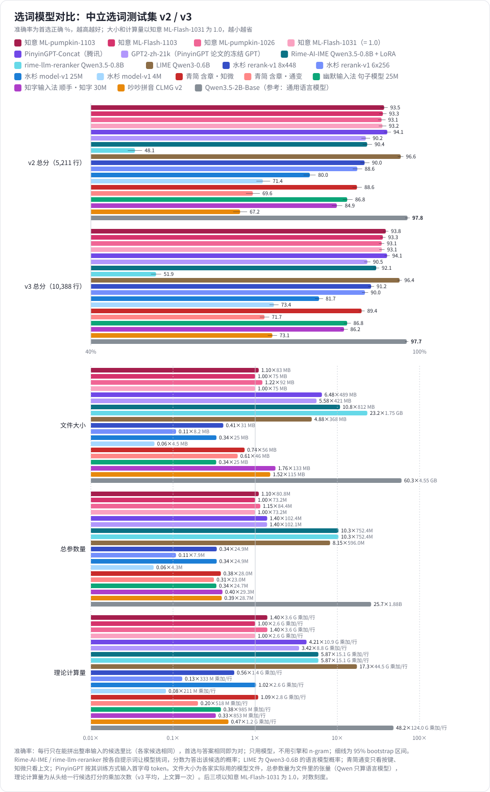
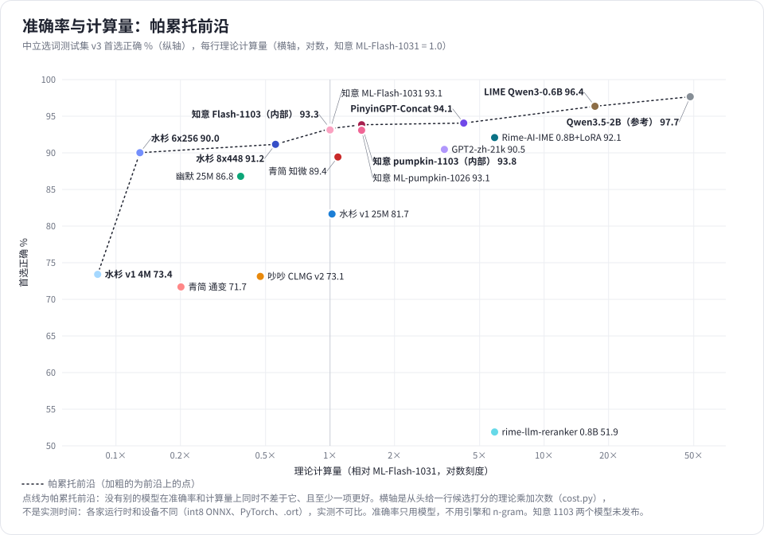
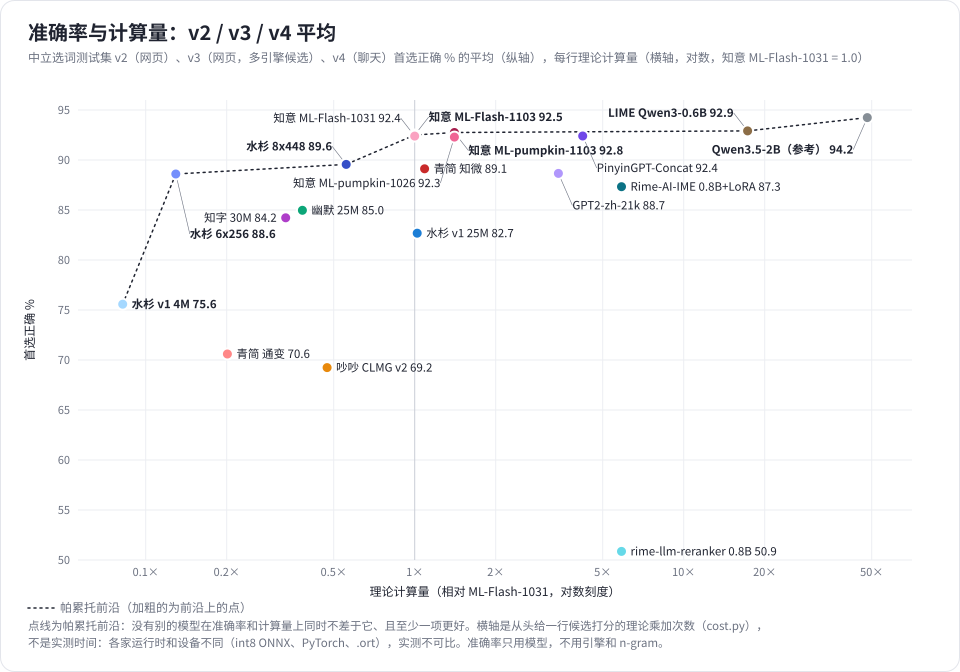
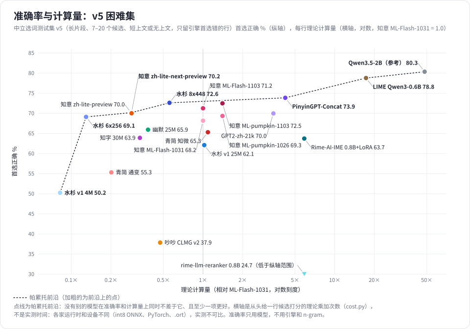

# 选词 / 组句模型对比：知意、PinyinGPT、Rime 插件、LIME、水杉、青简、幽默、知字、吵吵

各输入法的神经排序模型在[中立选词测试集 v2](../../benchmarks/neutral-v2/)、[v3](../../benchmarks/neutral-v3/)（网页）、[v4](../../benchmarks/neutral-v4/)（聊天）和 [v5](../../benchmarks/neutral-v5/)（困难集）上的首选准确率，只用模型，不用任何引擎和 n-gram；另附一项整句组句测试。Qwen3.5-2B-Base 作为通用语言模型的参考。测试日期：2026-11-03。

> **说明**：测试结果仅供参考。除知意和青简（调用青简自己的代码）外，各家模型都是按其公开的文件格式和源码自己实现读取和打分，没有运行各家的输入法，难免与原作者的实际用法有出入；测试集、打分方式的偏差见下文。如果发现任何问题（读取或打分有误、版本不对、对哪一家不公平等），请到 [Issues](https://github.com/dd1000001000/zhiyi_models/issues) 提出，我们会核对并更正。
>
> **欢迎加入对比**：如果你希望把自己的模型加入这个对比，请在 [Issues](https://github.com/dd1000001000/zhiyi_models/issues) 里提出并附上模型的下载地址和用法说明，我们会联系你，按同样的题目和规则测试。









## 测了哪些

| 模型 | 版本和文件 | 大小 | sha256 | 来源 | 许可 |
|---|---|---|---|---|---|
| 知意 ML-pumpkin-1026 | Release `model-ml-pumpkin-1026` 的 `laya-ml-pumpkin-1026-int8g.zip` 里的 `laya.int8g.onnx`，12 层 | 92 MB | `bbf51918…7a06` | 本仓库 | Apache-2.0 |
| 知意 ML-Flash-1031 | Release `model-ml-flash-1031` 的 `laya-ml-flash-1031-int8g.zip` 里的 `laya.int8g.onnx`，8 层 | 75 MB | `4cd47566…92ca` | 本仓库 | Apache-2.0 |
| 知意 ML-pumpkin-1103 | Release [`model-ml-pumpkin-1103`](https://github.com/dd1000001000/zhiyi_models/releases/tag/model-ml-pumpkin-1103) 的 `laya-ml-pumpkin-1103-int8g.zip` 里的 `laya.int8g.onnx`，12 层（测试时尚未发布，后于 2026-11-03 发布） | 83 MB | `5ca51a94…eb08` | 本仓库 | Apache-2.0 |
| 知意 ML-Flash-1103 | Release [`model-ml-flash-1103`](https://github.com/dd1000001000/zhiyi_models/releases/tag/model-ml-flash-1103) 的 `laya-ml-flash-1103-int8g.zip` 里的 `laya.int8g.onnx`，8 层（同上） | 75 MB | `6396bffe…d7b7` | 本仓库 | Apache-2.0 |
| PinyinGPT-Concat | Hugging Face `aihijo/transformers4ime-pinyingpt-concat` 的 `pytorch_model.bin`：GPT-2 12 层 × 768，词表 21,128 + 443 个拼音 token | 489 MB | `1c5ebb9e…74bb` | Tan 等，ACL 2022（腾讯 AI Lab）；代码 [VisualJoyce/Transformers4IME](https://github.com/VisualJoyce/Transformers4IME) `8f1573e` | CC BY-NC-SA 4.0 |
| GPT2-zh-21k | Hugging Face `aihijo/gpt2-zh-21k` 的 `model.safetensors`：同一论文里冻结使用的中文 GPT | 421 MB | `645284b6…78c6` | 同上 | CC BY-NC-SA 4.0 |
| Rime-AI-IME 重排模型 | [oc160/Rime-AI-IME](https://github.com/oc160/Rime-AI-IME)（`aa87a4a`）Release `v0.1.0-model`：Qwen3.5-0.8B 的 LoRA `adapter_v1.zip`（与 `qwen35-08b-ime-v1-Q8_0.gguf` 同一份权重），底座 Hugging Face `Qwen/Qwen3.5-0.8B`（`2fc0636`） | 812 MB（GGUF） | GGUF `da81b612…49dd`，adapter `412f58aa…c0dc`，底座 `04b1c301…4696` | 同左 | 代码 MIT；底座 Apache-2.0 |
| rime-llm-reranker | [FuJiK0/rime-llm-reranker](https://github.com/FuJiK0/rime-llm-reranker)（`700ad82`）：不训练，默认用 Qwen3.5-0.8B（同上的底座） | 1.75 GB（bf16） | 同上底座 | 同左 | MIT；底座 Apache-2.0 |
| LIME | [xushengfeng/lime](https://github.com/xushengfeng/lime)（`7d5a82d`）的 `lime-v1` 算法：不训练，用 Qwen3-0.6B（它跑 `unsloth/Qwen3-0.6B-GGUF` 的 IQ4_XS；这里用 Hugging Face `Qwen/Qwen3-0.6B` `c1899de` 的 bf16 权重） | 368 MB（IQ4_XS） | `f47f7117…874b`（bf16） | 同左 | 代码 GPL-3.0；模型 Apache-2.0 |
| 水杉 rerank-v1 8x448 | [metasequoiaime/chinese-ime-lm](https://github.com/metasequoiaime/chinese-ime-lm) Release `rerank-v1`（2026-11-01）的 `rerank-8x448.ort` 及其 `.model.json`、`.vocab.json` | 31 MB | `ad729f94…4a93` | 同左 | Apache-2.0 |
| 水杉 rerank-v1 6x256 | 同上，`rerank-6x256.ort` | 8.2 MB | `ceeb3a8d…bad4` | 同左 | Apache-2.0 |
| 水杉 model-v1 25M | 同一仓库 Release `model-v1`（2026-09-18）的 `sentence-model-desktop.safetensors`（即 Hugging Face `pinyin-ime-reranker-25M`），整句重排模型 | 25 MB | `0a6ecba6…b469` | 同左 | Apache-2.0 |
| 水杉 model-v1 4M | 同上，`sentence-model.safetensors`（`pinyin-ime-reranker-4M`；Rime-AI-IME 的安卓版也用它） | 4.5 MB | `86ac5295…d1c1` | 同左 | Apache-2.0 |
| 青简 含章·通变 | [qingjian-team/qingjian](https://github.com/qingjian-team/qingjian) Release `data-v9`（2026-10-30）的 `hanzhang-tongbian-small.qjm`：字级 GPT，8 层 × 448，按拼音出字（P2C） | 46 MB | `4eabcb14…f973`（包 `bc8dd7f4…694b`） | 同左；代码 `97dde30` | GPL-3.0-or-later |
| 青简 含章·知微 | 同一仓库 Release `data-v7`（2026-10-13）的 `hanzhang-zhiwei-small.qjm`：字级 GPT，8 层 × 448，按上文给候选打分；0.3.2 起已下线 | 56 MB | `83ad55ab…b0ef`（包 `e259f8bc…9e40`） | 同左 | GPL-3.0-or-later |
| 幽默输入法 句子模型 25M | [Sraw/youmo-ime](https://github.com/Sraw/youmo-ime) Release `sentence-models-20261001` 的 `sentence-model-large.safetensors` | 25 MB | `6f7fcb72…669a` | 同左 | Apache-2.0 |
| 知字输入法 顺手·知字 30M | Hugging Face [`DabbleCove/shunshou-zhizi-30m`](https://huggingface.co/DabbleCove/shunshou-zhizi-30m)（`b74f570`）的 `zhizi30m_v2.onnx` 和 `itos.json`：字级 GPT，8 层 × 512，字表 7,745；输入法 [lihytaihe-lang/zhizi](https://github.com/lihytaihe-lang/zhizi) 0.1.5 | 133 MB | `07c8a48d…358b` | 同左 | 权重 CC BY-SA 4.0；输入法代码 Apache-2.0 |
| 吵吵拼音 CLMG v2 | [yangchaoliuyang/chaoinput](https://github.com/yangchaoliuyang/chaoinput) Release `v3.3.16`：`ChaoInput-v3.3.16-win64.zip` 里的 `data/lmt.bin` 和 `data/dict.db`，结构按源码包的 `ChaoInput.LmTrain.Gpu/model.py` | 115 MB（`lmt.bin`） | `f9052324…f8b8`（`dict.db` `51fd6c85…fd1b`） | 同左 | MIT |
| CNMBert | Hugging Face `Midsummra/CNMBert`（`7802eae`）的 `model.safetensors`：BERT 1.31 亿参数，把拼音首字母还原成汉字；代码 [IgarashiAkatuki/zh-CN-Multi-Mask-Bert](https://github.com/IgarashiAkatuki/zh-CN-Multi-Mask-Bert) | 523 MB | `89761d19…4ab2` | Feng 等，IJCNN 2025 | AGPL-3.0 |
| Qwen3.5-2B-Base（参考） | Hugging Face `Qwen/Qwen3.5-2B-Base` | 4.55 GB | `928acbf1…df2d` | 通义千问 | Apache-2.0 |

测试集：`neutral-v2.jsonl`（sha256 `1d624a68…6a06ff`，计分 5,211 行）、`neutral-v3.jsonl`（`5d9dc858…fe4b`，计分 10,388 行）、`neutral-v4.jsonl`（`a86155bc…8ab8b81`，计分 17,072 行）、`neutral-v5.jsonl`（`6122bc27…1cf59`，计分 5,220 行），都在本仓库的同名 Release 里。组句测试用我们内部的中立集 v1（12,000 个长分句，`35131f7f…4a5a`），**未公开**，所以组句结果别人暂时无法复现。

## 怎么测

- 每行只在能拼出整串输入的候选里比（`whole`），各家候选相同；分最高的候选和答案（`best`）相同即为对。
- 每家按自己的方式打分，代码见下表和「文件」一节。知意以外的打分和以前的私有测试结果逐一核对过：吵吵、水杉、幽默的分数差在 1e-4 以内，Qwen（bf16）首选全部一致。

| 模型 | 上文 | 拼音怎么给 | 候选怎么给 | 分数 |
|---|---|---|---|---|
| 知意 | 最后 128 个词元 | 打的码按首选候选的读音切成音节槽，全拼或首字母照原样 | 整页候选一起进模型（包括不能拼出整串的） | 选词头对每个候选的 logit |
| PinyinGPT-Concat | `[CLS]` 加上文最后 100 字（它训练时最长 128 个 token） | `[SEP]` 后接每个音节的拼音 token。**它发布的模型只用首字母训练过**（仓库的 `pretrain_pinyingpt.sh`：`--abbr_mode full`），所以输入一律用首字母 token（`[z]`）；每个字的概率只在所打拼音允许的字里算（全拼音节用该音节的字，只打首字母时用该字母的字） | 候选的字逐个强制喂入，位置号沿用对应拼音 token 的位置（同其 `pinyingpt_concat.py`） | 各字受约束的 log P 之和 |
| GPT2-zh-21k | 同上 | 不进模型，只做约束（同其 `pinyingpt_compatible.py`） | 候选逐字接在上文后 | 同上 |
| Rime-AI-IME | 上文最后 60 字（它的 `context_length`） | 所打的拼音原样写进提示词 | 候选用顿号列在提示词里，按它 `sidecar.py` 的系统 / 用户提示词，不开思考 | log P(模型答出该候选 + 结束符) |
| rime-llm-reranker | 同上 | 同上 | 按它 `rime.lua` 的提示词（要求按顺序列出前 5 个） | log P(模型把该候选列在第一个 + 顿号) |
| LIME | 它的开头语「下面的内容主题多样」加上文，没有起始符（同其 `init_ctx`） | 不给（它在生成时按拼音筛词元，这里只给候选打分） | 上文加候选整串一起分词 | log P(上文 + 候选) − log P(上文) |
| 水杉 rerank-v1 | `<bos>` 加最后 64 字 | 不给，它是字级语言模型 | 按它运行时逐键的方式：候选截成 1 字、2 字……逐页喂入，前缀共用缓存 | 最后一页的分数（每字平均 log P） |
| 水杉 model-v1 | `<bos>` 加上文末尾，长度给最长的候选留出位置 | 不给 | 候选逐字接在上文后 | 每字平均 log P（格式参考实现的 `SentenceModel::score`） |
| 青简 含章·通变 | 不看上文 | 所打的按键（它的 P2C：`<eos> 按键 <sep> 汉字`） | 每个候选逐字强制喂入 | 各字 log P 之和；用青简自己的 `CharScorer::score_p2c` |
| 青简 含章·知微 | `<eos>` 加上文（按模型的 128 上下文从左边截） | 不看按键 | 候选逐字接在上文后 | 各字 log P 之和；用青简自己的 `CharScorer::score` |
| 幽默 | 只给上文最后一行（去掉 `[URL]` 和换行，它的词表里没有） | 不给 | 候选逐字接在上文后 | 各字 log P 之和 |
| 知字 | `<bos>` 加上文最后一行的末尾，最多 32 字，并给最长的候选留出位置（模型输入固定 40 位）；同其 `ContextRankingScorer`，字表外的字记 `<unk>` | 不给 | 每 8 个候选一批，逐字接在上文后 | 各字 log P 之和 |
| 吵吵 | 最后 64 字 | 只用来查它词典里这个候选的词频 | 每个候选单独算 | log(10 + 词频) + 上文向量 · 候选字向量的平均 |
| CNMBert | `[CLS]` 加上文（共 64 个 token 以内） | 每个首字母一个专用遮罩 token（同其 `predict`） | 遮罩从左到右逐个填入候选的字，每步在整个词表上算 | 各步 log P 之和；**只测只打首字母的行** |
| Qwen3.5-2B（参考） | `<\|endoftext\|>` 加上文 | 不给 | 上文加候选整串一起分词 | log P(上文 + 候选) − log P(上文) |

需要注意的偏差：

- **PinyinGPT 的输入方式**：如果按所打的样子喂全拼 token（`[zhong]`），它的成绩是 v2 88.2、v3 89.4，比按训练方式喂首字母低 5–6 分；图和主表用的是后者。论文的做法是全拼交给冻结的 GPT（即 GPT2-zh-21k）、简拼交给 PinyinGPT，这里两者都单独列出。
- **上文长度**：PinyinGPT 只看最后 100 字。知意也在只给最后 100 字时重跑了一遍，四个模型变化都在 0.4 分以内（pumpkin-1103：v2 93.5 → 93.5，v3 93.8 → 93.6），所以差距不来自上文长度。
- **两个 Rime 插件**：它们在输入法里只把 Rime 的前 5 个候选交给模型，这里为了和别家比同一批候选，把每行能拼出整串的候选全部列进提示词（v2 约八成、v3 约一半的行超过 5 个）。Rime-AI-IME 用的是同一份 LoRA 权重的 bf16 版（它发布的是 Q8_0 GGUF）；它在输入法里置信度低于 0.6 时不动原顺序，这里只看模型选哪个。rime-llm-reranker 没有训练过，零样本时经常把顺序排乱，成绩低于引擎原顺序。
- **LIME**：它在输入法里逐字生成，只保留拼音对得上的词元，候选来自模型自己；这里只取它的模型（Qwen3-0.6B）给同一批候选打分，权重是 bf16，比它实际跑的 IQ4_XS 量化版精度更高。
- **青简**：用青简自己的 Rust 代码打分（见 [`qingjian/`](qingjian/)）。候选里有模型字表外的字时，青简这一行不重排、保持原顺序，这里同样按引擎原顺序取第一个（通变 v2 18 行、v3 767 行，知微 v2 1 行、v3 488 行）。通变只看按键、知微只看上文，都不是两者兼看；青简在输入法里还要把模型分和词图分按 0.5 混合，这里只比模型本身。
- **CNMBert** 只认拼音首字母，全拼的行它看不到完整拼音，所以只在只打首字母的行上测，不进图。
- **计算量不同**：PinyinGPT、GPT2 对每个候选单独跑一遍（上文可共用缓存），每个字算一次整个词表的 softmax；两个 Rime 插件和 LIME 用 6–8 亿参数的通用模型；知意一次前向给整页候选打分。各家的倍数见下面的表。
- PinyinGPT 的拼音表里没有某个字的这个读音时，把这个字加进该位置允许的字里，不让它直接得零分；它拼不出的候选（拉丁字母、词表外的字）记 −1e4，这些候选在两套题里都不是答案。
- 水杉、幽默在各自的输入法里还要加上解码器 / n-gram 的分数，这里只比模型本身，不能代表它们输入法的整体表现。
- **知字**：它在输入法里默认关闭（实验开关），打开后只在同读音、同长度的一组候选里重排，取「模型分 − 2 × 词库原排名」最高的；这里只比模型本身。它的输入法只记同一个程序里最近上屏的 32 个字作为上文，这里给的是测试集的上文（最后一行，最多 32 字）。
- PinyinGPT、GPT2-zh-21k 为 CC BY-NC-SA 4.0，CNMBert 为 AGPL-3.0，这里只做评测，不分发它们的权重。
- v3 是 2026 年 10 月的网页，晚于各家的训练数据；知意 1103 两个模型训练时没有用到 v2、v3、v1 的任何内容。

## 结果：选词（首选准确率 %）

| | v2 全部 | v3 全部 | v3 全拼 | v3 首字母 | v3 部分 / 混拼 | v3 短词 | v3 两词 | v3 长句 |
|---|---|---|---|---|---|---|---|---|
| 行数 | 5,211 | 10,388 | 7,423 | 709 | 2,256 | 7,735 | 913 | 1,740 |
| 知意 ML-pumpkin-1103 | 93.5 | 93.8 | 95.3 | 83.9 | 92.2 | 93.5 | 95.1 | 94.7 |
| 知意 ML-Flash-1103 | 93.3 | 93.3 | 95.0 | 82.4 | 91.2 | 92.9 | 93.5 | 94.9 |
| 知意 ML-pumpkin-1026 | 93.1 | 93.1 | 94.8 | 82.5 | 90.7 | 92.7 | 94.2 | 94.1 |
| 知意 ML-Flash-1031 | 93.2 | 93.1 | 94.8 | 82.5 | 91.1 | 92.8 | 93.3 | 94.6 |
| PinyinGPT-Concat（腾讯） | 94.1 | 94.1 | 95.2 | 87.7 | 92.5 | 93.6 | 95.6 | 95.4 |
| GPT2-zh-21k（PinyinGPT 论文的冻结 GPT） | 90.2 | 90.5 | 92.1 | 82.2 | 87.5 | 90.0 | 91.7 | 92.0 |
| Rime-AI-IME Qwen3.5-0.8B + LoRA | 90.4 | 92.1 | 93.3 | 83.8 | 90.6 | 92.3 | 91.9 | 91.3 |
| rime-llm-reranker Qwen3.5-0.8B | 48.1 | 51.9 | 55.9 | 35.1 | 44.1 | 49.7 | 56.2 | 59.6 |
| LIME Qwen3-0.6B | 96.6 | 96.4 | 97.0 | 92.9 | 95.4 | 95.8 | 97.5 | 98.3 |
| 水杉 rerank-v1 8x448 | 90.0 | 91.2 | 92.7 | 82.1 | 89.1 | 90.2 | 93.5 | 94.3 |
| 水杉 rerank-v1 6x256 | 88.6 | 90.0 | 91.9 | 78.7 | 87.5 | 88.8 | 93.1 | 93.9 |
| 水杉 model-v1 25M | 80.0 | 81.7 | 83.4 | 68.1 | 80.1 | 79.8 | 87.0 | 87.2 |
| 水杉 model-v1 4M | 71.4 | 73.4 | 76.1 | 55.0 | 70.2 | 71.3 | 80.3 | 79.3 |
| 青简 含章·知微 | 88.6 | 89.4 | 91.8 | 76.0 | 85.9 | 88.6 | 91.3 | 92.0 |
| 青简 含章·通变 | 69.6 | 71.7 | 80.0 | 29.3 | 57.6 | 68.1 | 78.5 | 84.1 |
| 幽默输入法 句子模型 25M | 86.8 | 86.8 | 89.5 | 70.1 | 83.2 | 85.8 | 89.6 | 89.7 |
| 知字输入法 顺手·知字 30M | 84.9 | 86.2 | 89.0 | 70.2 | 82.1 | 85.3 | 89.7 | 88.6 |
| 吵吵拼音 CLMG v2 | 67.2 | 73.1 | 82.1 | 50.9 | 50.7 | 77.2 | 66.3 | 58.8 |
| CNMBert（只测首字母行） | — | — | — | 60.5 | — | — | — | — |
| Qwen3.5-2B-Base（参考：通用语言模型） | **97.8** | **97.7** | **98.0** | **95.6** | **97.3** | **97.3** | **98.7** | **98.7** |

和知意 pumpkin-1103 逐行配对（McNemar）：

- LIME：v2 +3.0（95% 区间 +2.4 ~ +3.7），v3 +2.5（+2.1 ~ +3.0），都显著（p < 1e-18）。
- PinyinGPT-Concat：v2 +0.6（−0.2 ~ +1.2，p = 0.11），v3 +0.2（−0.3 ~ +0.7，p = 0.37），都不显著；对 ML-Flash-1031 为 +0.9（v2 p = 0.019，v3 p = 0.0003）。差距主要在只打首字母的行。
- Rime-AI-IME：v2 −3.1（−3.9 ~ −2.2），v3 −1.8（−2.3 ~ −1.2）。
- 青简 含章·知微：v3 −4.4（−5.0 ~ −3.8）。

## 结果：聊天 v4 与困难集 v5（首选准确率 %）

v4 是聊天（LCCC 对话，上文是前面几句话，79% 的计分行是单个词）；v5 是困难集（长片段、7–20 个候选、三分之二的行上文很短或没有，只留出候选的引擎自己排错了的行，所以引擎原顺序在 v5 上是 0）。打分方式和上面相同，每列最高分加粗。

| | v4 全部 | v4 无上文 | v4 首字母 | v4 长句 | v5 全部 | v5 无上文 | v5 上文 1–32 字 | v5 上文 33 字以上 | v5 首字母 | v5 两词 |
|---|---|---|---|---|---|---|---|---|---|---|
| 行数 | 17,072 | 1,234 | 777 | 2,073 | 5,220 | 1,813 | 1,878 | 1,529 | 739 | 1,782 |
| 引擎原顺序 | 79.4 | 79.3 | 45.4 | 78.1 | 0 | 0 | 0 | 0 | 0 | 0 |
| 知意 ML-pumpkin-1103 | **90.9** | 84.8 | 74.5 | 89.5 | 72.5 | 62.7 | 71.7 | 85.1 | 61.6 | 66.4 |
| 知意 ML-Flash-1103 | **90.9** | 84.8 | 75.9 | 89.3 | 71.2 | 62.2 | 70.3 | 83.1 | 61.2 | 65.4 |
| 知意 ML-pumpkin-1026 | 90.7 | **87.1** | **77.0** | 89.0 | 69.3 | 55.5 | 70.3 | 84.5 | 54.5 | 62.6 |
| 知意 ML-Flash-1031 | 90.8 | 86.8 | 76.2 | 89.5 | 68.2 | 54.3 | 69.5 | 83.0 | 56.7 | 60.9 |
| PinyinGPT-Concat（腾讯） | 89.0 | 77.6 | 73.2 | 88.1 | 73.9 | 59.2 | 76.3 | 88.2 | 65.1 | 67.7 |
| GPT2-zh-21k（PinyinGPT 论文的冻结 GPT） | 85.3 | 74.6 | 63.6 | 85.0 | 70.0 | 55.4 | 72.2 | 84.5 | 62.7 | 62.3 |
| Rime-AI-IME Qwen3.5-0.8B + LoRA | 79.4 | 56.8 | 56.5 | 73.1 | 63.7 | 45.1 | 67.5 | 81.2 | 55.1 | 59.9 |
| rime-llm-reranker Qwen3.5-0.8B | 52.6 | 37.8 | 38.0 | 53.6 | 24.7 | 22.1 | 22.5 | 30.6 | 17.3 | 22.8 |
| LIME Qwen3-0.6B | 85.8 | 65.6 | 65.6 | 86.4 | 78.8 | **63.8** | 81.6 | 93.0 | 66.4 | 71.7 |
| 水杉 rerank-v1 8x448 | 87.6 | 81.0 | 75.3 | 90.9 | 72.6 | 62.2 | 73.5 | 83.8 | 64.0 | 66.0 |
| 水杉 rerank-v1 6x256 | 87.1 | 81.5 | 73.6 | 90.2 | 69.1 | 58.7 | 70.4 | 79.9 | 58.5 | 62.3 |
| 水杉 model-v1 25M | 86.4 | 83.5 | 73.7 | 89.3 | 62.1 | 54.1 | 62.7 | 70.8 | 53.3 | 57.2 |
| 水杉 model-v1 4M | 81.9 | 80.6 | 65.6 | 83.6 | 50.2 | 44.8 | 49.9 | 57.0 | 41.3 | 46.7 |
| 青简 含章·知微 | 89.3 | 84.7 | 74.8 | **91.9** | 65.3 | 54.3 | 65.0 | 78.7 | 54.0 | 57.2 |
| 青简 含章·通变 | 70.5 | 74.7 | 31.1 | 77.7 | 55.3 | 54.9 | 55.0 | 56.2 | 37.6 | 43.3 |
| 幽默输入法 句子模型 25M | 81.3 | 75.5 | 59.5 | 81.9 | 65.9 | 57.3 | 67.8 | 73.9 | 54.1 | 59.1 |
| 知字输入法 顺手·知字 30M | 81.5 | 75.3 | 60.5 | 79.5 | 63.9 | 55.9 | 65.7 | 71.1 | 51.6 | 57.1 |
| 吵吵拼音 CLMG v2 | 67.4 | 39.9 | 33.2 | 43.6 | 37.9 | 24.2 | 39.6 | 51.9 | 34.6 | 37.7 |
| CNMBert（只测首字母行） | — | — | 62.7 | — | — | — | — | — | 40.6 | — |
| Qwen3.5-2B-Base（参考：通用语言模型） | 87.3 | 54.7 | 69.6 | 89.4 | **80.3** | 62.7 | **84.8** | **95.8** | **70.5** | **72.6** |

- **聊天**：通用语言模型和以它为底座的方法在 v4 上明显变弱（Qwen 2B 87.3、LIME 85.8），对话第一句没有上文时尤其如此（Qwen 54.7、LIME 65.6）；知意、青简知微、水杉这类专门的选词模型在没有上文时仍在 80 分以上。
- **困难集**：v5 上各家都掉到 25–80 分。有长上文（33 字以上）时，大模型的世界知识优势最明显（Qwen 95.8、LIME 93.0），没有上文时最好的也只有 64 分左右（LIME 63.8，知意 pumpkin-1103 和 Qwen 都是 62.7）。
- v5 只留下引擎排错的行，其中约 5% 的题两种写法都说得通（见 [v5 的说明](../../benchmarks/neutral-v5/)），所以上限不是 100%。
- 上面两张帕累托图：一张用 v2、v3、v4 三套的平均分，一张只用 v5；横轴同上，为理论计算量。

### 大小和计算量（图中以知意 ML-Flash-1031 为 1.0）

| 模型 | 文件大小 | 总参数量 | 理论计算量（v3 每行乘加） |
|---|---|---|---|
| 知意 ML-pumpkin-1103 | 83 MB（1.10） | 80.8M（1.10） | 3.6 G（1.40） |
| 知意 ML-Flash-1103 | 75 MB（1.00） | 73.2M（1.00） | 2.6 G（1.00） |
| 知意 ML-pumpkin-1026 | 92 MB（1.22） | 84.4M（1.15） | 3.6 G（1.40） |
| 知意 ML-Flash-1031 | 75 MB（1.00） | 73.2M（1.00） | 2.6 G（1.00） |
| PinyinGPT-Concat（腾讯） | 489 MB（6.48） | 102.4M（1.40） | 10.9 G（4.21） |
| GPT2-zh-21k（PinyinGPT 论文的冻结 GPT） | 421 MB（5.58） | 102.1M（1.40） | 8.8 G（3.42） |
| Rime-AI-IME Qwen3.5-0.8B + LoRA | 812 MB（10.77） | 752.4M（10.28） | 15.1 G（5.87） |
| rime-llm-reranker Qwen3.5-0.8B | 1.75 GB（23.17） | 752.4M（10.28） | 15.1 G（5.87） |
| LIME Qwen3-0.6B | 368 MB（4.88） | 596.0M（8.15） | 44.5 G（17.29） |
| 水杉 rerank-v1 8x448 | 31 MB（0.41） | 24.9M（0.34） | 1.4 G（0.56） |
| 水杉 rerank-v1 6x256 | 8.2 MB（0.11） | 7.9M（0.11） | 333 M（0.13） |
| 水杉 model-v1 25M | 25 MB（0.34） | 24.9M（0.34） | 2.6 G（1.02） |
| 水杉 model-v1 4M | 4.5 MB（0.06） | 4.3M（0.06） | 211 M（0.08） |
| 青简 含章·知微 | 56 MB（0.74） | 28.0M（0.38） | 2.8 G（1.09） |
| 青简 含章·通变 | 46 MB（0.61） | 23.0M（0.31） | 518 M（0.20） |
| 幽默输入法 句子模型 25M | 25 MB（0.34） | 24.7M（0.34） | 985 M（0.38） |
| 知字输入法 顺手·知字 30M | 133 MB（1.76） | 29.3M（0.40） | 853 M（0.33） |
| 吵吵拼音 CLMG v2 | 115 MB（1.52） | 28.7M（0.39） | 1.2 G（0.47） |
| CNMBert（只测首字母行） | 523 MB（6.93） | 130.6M（1.79） | 172.6 G（67.03） |
| Qwen3.5-2B-Base（参考：通用语言模型） | 4.55 GB（60.32） | 1.88B（25.72） | 124.0 G（48.15） |

- 文件大小：各家实际用的模型文件。知意为 int8 ONNX，水杉 rerank-v1 为 `.ort`，水杉 model-v1 和幽默为 int8 safetensors，青简为 f16 的 `.qjm`，知字为 fp32 ONNX（Windows 版用它，macOS 用 Core ML fp16），吵吵为 fp32 的 `lmt.bin`（不含词典 `dict.db`），PinyinGPT / GPT2 / CNMBert 为 fp32 权重，Rime-AI-IME 为它发布的 Q8_0 GGUF，rime-llm-reranker 为 bf16（它默认的 MLX bf16），LIME 为它跑的 IQ4_XS GGUF，Qwen 2B 为 bf16 且含视觉部分。
- 总参数量：文件里的张量个数。知意按 ONNX 的权重数，其中约 4,875 万是词嵌入；水杉 rerank-v1 的 `.ort` 无法直接读出张量，按其 `model.json` 的结构算；Qwen 系列只算语言模型部分，绑定的输出层不重复计；知字的 ONNX 里绑定的输出层多存了一份，同样只计一次。
- 理论计算量：从头给一行的整串候选打分的乘加次数，按 v3 计分行平均（`cost.py`）。上文只算一次（因果模型的上文 K/V 各候选共用），各词元过线性层，注意力按各词元看到的长度算，逐字算整个词表 softmax 的模型另加输出层（水杉 6x256 是自归一化的，只算候选字那一项）。两个 Rime 插件为提示词（含候选列表）算一次、再加各候选的回答；CNMBert 每个候选每个字一次完整前向（只算首字母行）。知意为整页一次前向（编码器 + 选词头，不算组句头）；在输入法里知意 Flash 的上文可以缓存，这里没有扣除。

## 结果：组句（P@1 / P@5 %）

整句的拼音一次打完，模型直接给出整句，和原句完全相同才算对。题目是中立集 v1 的 12,000 个长分句（4–16 字），全拼、末字只打首字母、混拼、全部首字母各 3,000 句，上文为空、1–32 字、33–128 字各 4,000 句。这一项只比能自己出整句的模型。

| | 行数 | 知意 pumpkin-1103 | 知意 Flash-1103 | 知意 ML-pumpkin-1026 | 知意 ML-Flash-1031 | PinyinGPT-Concat | GPT2-zh-21k |
|---|---|---|---|---|---|---|---|
| 全部 | 12,000 | 33.2 / 44.0 | 30.6 / 42.2 | 30.7 / 41.8 | 30.5 / 41.5 | **48.2** / 64.2 | 31.4 / 46.4 |
| 全拼 | 3,000 | 58.3 / 72.8 | 55.0 / 71.1 | 55.4 / 70.8 | 55.2 / 70.0 | **63.0** / 78.8 | 42.9 / 62.4 |
| 末字只打首字母 | 3,000 | 45.6 / 60.3 | 42.1 / 58.0 | 41.5 / 56.8 | 41.6 / 57.4 | **59.7** / 76.9 | 43.2 / 62.1 |
| 混拼 | 3,000 | 21.9 / 32.0 | 19.5 / 29.8 | 19.8 / 29.6 | 19.2 / 29.3 | **41.5** / 57.6 | 24.4 / 37.5 |
| 全部首字母 | 3,000 | 6.9 / 10.9 | 5.9 / 10.0 | 6.2 / 9.9 | 5.9 / 9.1 | **28.6** / 43.2 | 15.2 / 23.4 |
| 无上文 | 4,000 | 22.1 / 30.9 | 19.7 / 29.4 | 20.2 / 28.9 | 19.6 / 29.2 | **33.4** / 49.4 | 19.6 / 31.8 |
| 上文 1–32 字 | 4,000 | 34.5 / 46.1 | 31.1 / 43.8 | 31.6 / 43.5 | 31.2 / 42.6 | **50.7** / 67.3 | 32.4 / 47.9 |
| 上文 33–128 字 | 4,000 | 42.9 / 55.0 | 41.2 / 53.5 | 40.5 / 53.0 | 40.6 / 52.5 | **60.5** / 75.7 | 42.2 / 59.4 |

- 知意：组句头一次前向，所有字位同时给出，各字位取前 5 个字后组合出 n-best。知意输入法里的组句还会多轮修正并加 n-gram，这里没有用。
- PinyinGPT / GPT2-zh-21k：受拼音约束的 beam search，16 束，同论文的评测设置；PinyinGPT 的输入同上，用首字母 token。逐字解码，每句的计算量比知意的一次前向大得多。
- 只比原句完全相同，同音的其他合理写法也算错。

## 复现

需要 Python 3、numpy、PyTorch（CUDA）、transformers、peft、safetensors、tokenizers、pypinyin、onnx、onnxruntime；知意的 ONNX 在 DirectML 上跑时用 onnxruntime-directml（加 `--cpu` 则用 CPU），所以分两个环境跑。青简另需按 [`qingjian/README.md`](qingjian/README.md) 在青简源码里编出 `qj-score`。先下载上表的文件，解开知意的 int8 zip、吵吵的两个 zip、Rime-AI-IME 的 `adapter_v1.zip` 和青简的数据包：

```bash
python run.py --v2 neutral-v2.jsonl --v3 neutral-v3.jsonl --zhiyi zhiyi-pumpkin-1026=laya-ml-pumpkin-1026-int8g --zhiyi zhiyi-flash-1031=laya-ml-flash-1031-int8g --metasequoia rerank-v1
```

```bash
python run.py --v2 neutral-v2.jsonl --v3 neutral-v3.jsonl --youmo sentence-model-large.safetensors --chaoinput ChaoInput-v3.3.16-win64/data,ChaoInput-src-v3.3.16/src/ChaoInput.LmTrain.Gpu/model.py --qwen Qwen3.5-2B-Base --pinyingpt transformers4ime-pinyingpt-concat --gpt2-zh-21k gpt2-zh-21k
```

```bash
python run.py --v2 neutral-v2.jsonl --v3 neutral-v3.jsonl --metaseq-v1-4m sentence-model.safetensors --metaseq-v1-25m sentence-model-desktop.safetensors --rime-ai-ime Qwen3.5-0.8B,adapter_v1 --fujik0 Qwen3.5-0.8B --lime Qwen3-0.6B --cnmbert CNMBert --qingjian qj-score.exe,hanzhang-tongbian-small.qjm,hanzhang-zhiwei-small.qjm --zhizi shunshou-zhizi-30m
```

```bash
python cost.py --v3 neutral-v3.jsonl --zhiyi zhiyi-flash-1031=laya-ml-flash-1031-int8g --metasequoia rerank-v1 --youmo sentence-model-large.safetensors --chaoinput ChaoInput-v3.3.16-win64/data,ChaoInput-src-v3.3.16/src/ChaoInput.LmTrain.Gpu/model.py --qwen Qwen3.5-2B-Base --pinyingpt transformers4ime-pinyingpt-concat --gpt2-zh-21k gpt2-zh-21k --metaseq-v1-4m sentence-model.safetensors --metaseq-v1-25m sentence-model-desktop.safetensors --rime-ai-ime Qwen3.5-0.8B,qwen35-08b-ime-v1-Q8_0.gguf --fujik0 Qwen3.5-0.8B,Qwen3.5-0.8B/model.safetensors-00001-of-00001.safetensors --lime Qwen3-0.6B,367804096 --cnmbert CNMBert --qingjian hanzhang-tongbian-small.qjm,hanzhang-zhiwei-small.qjm --zhizi shunshou-zhizi-30m
```

```bash
python chart.py --v2 neutral-v2.jsonl --v3 neutral-v3.jsonl --v4 neutral-v4.jsonl --v5 neutral-v5.jsonl
```

v4、v5 的打分：上面三条 `run.py` 命令都加上 `--v4 neutral-v4.jsonl --v5 neutral-v5.jsonl`（已有的 v2、v3 分数文件会直接沿用），另加 `--zhiyi zhiyi-pumpkin-1103=… --zhiyi zhiyi-flash-1103=… --zhizi shunshou-zhizi-30m`。

其他选项：`run.py --context_chars 100` 只给知意最后 100 字上文（结果名加 `-ctx100`）；`run.py --pinyingpt-typed <目录>` 按所打的样子给 PinyinGPT 喂拼音（`pinyingpt-concat-typed`）。组句用 `compose.py --v1 <v1 测试集> --zhiyi … --pinyingpt … --gpt2-zh-21k …`。

## 文件

| 文件 | 内容 |
|---|---|
| `run.py` | 选词：给每行的候选打分，写 `scores/` 和 `results.json` |
| `compose.py` | 组句：每行输出前 5 句，写 `compose/`（不随仓库发布：很多输出就是未公开的 v1 原句）和 `results.json` 的 `compose` |
| `cost.py` | 数文件大小、参数量，算每行理论计算量，写 `cost.json` |
| `chart.py` | 从 `scores/` 和 `cost.json` 画 `media/models_compare.zh-CN.svg`（v2、v3 总分，文件大小、参数量、计算量）、`media/models_pareto.zh-CN.svg`（v3 准确率对计算量的帕累托前沿），以及 `models_pareto_v234.zh-CN.svg`（v2、v3、v4 平均）和 `models_pareto_v5.zh-CN.svg`（v5） |
| `zhiyi.py` | 知意 int8 ONNX：选词序列（整页）和组句序列、拼音槽对齐、组句的拼音约束 |
| `pinyingpt.py` | PinyinGPT-Concat / GPT2-zh-21k：受约束的候选打分和 beam search |
| `chat_judge.py` | Rime-AI-IME（底座 + LoRA）与 rime-llm-reranker：各自的提示词，答出每个候选的概率 |
| `qwen.py` | Qwen 的 log P(上文 + 候选) − log P(上文)；LIME 用同一份代码加它的开头语 |
| `metasequoia.py` | 水杉 rerank-v1 `.ort` 的逐键打分 |
| `metaseq_v1.py` | 水杉 model-v1（chinese-ime-lm 格式）的整句打分 |
| `qingjian.py`、`qingjian/` | 青简：调用 `qj-score`（在青简源码里编译的 Rust 小工具，直接用青简的 `CharScorer` 和 `BigramModel`） |
| `cnmbert.py` | CNMBert 的首字母遮罩逐字填充打分 |
| `youmo.py` | 幽默句子模型（chinese-ime-lm 格式）的 PyTorch 实现和打分 |
| `zhizi30m.py` | 知字 30M：用 onnxruntime（CPU）跑它的 ONNX，按它的输入格式打分 |
| `chaoinput.py` | 吵吵 CLMG v2（`lmt.bin`）和词典先验 |
| `scores/` | 每个模型在每套题（v2–v5）上的分数，`{"id", "scores"}`，不比的候选为 null；含 `-ctx100` 和 `pinyingpt-concat-typed` 两种附加测试 |
| `results.json` | 各组的行数和准确率；`compose` 为组句的 P@1 / P@5 |
| `cost.json` | 各模型的文件大小、参数量和每行乘加次数 |
