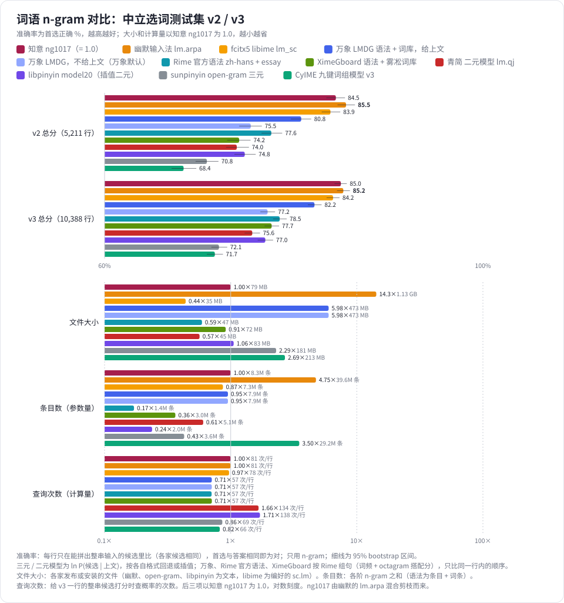
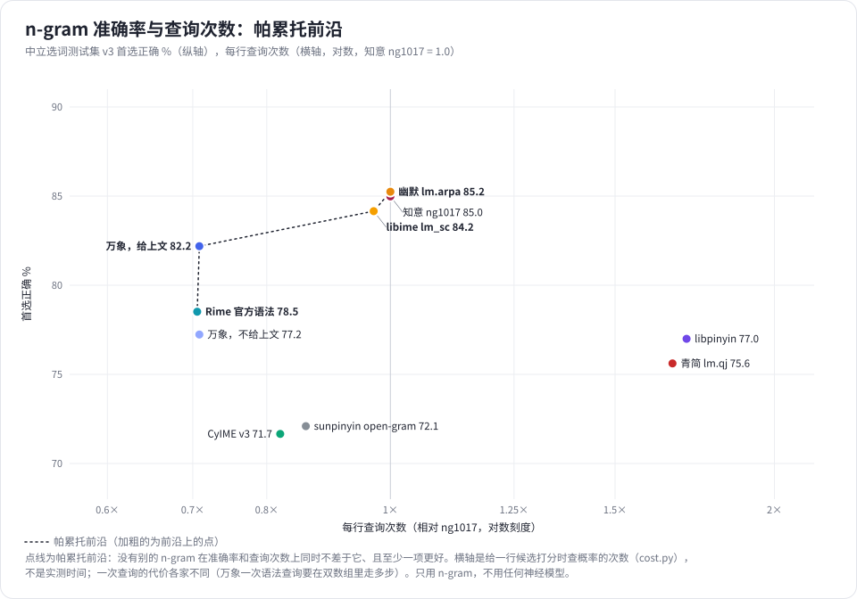

# 词语 n-gram 对比：知意、幽默、libime、万象、Rime、青简、libpinyin、sunpinyin、CyIME

各输入法的词语 n-gram 在[中立选词测试集 v2](../../benchmarks/neutral-v2/) 和 [v3](../../benchmarks/neutral-v3/) 上的首选准确率，只用 n-gram，不用任何神经模型。全部在 CPU 上单进程跑，每个 n-gram 跑一套题只要几秒到几分钟。测试日期：2026-11-03。

> **说明**：测试结果仅供参考。除青简（调用青简自己的代码）外，各家的 n-gram 都是按其公开的文件格式自己实现读取和打分，没有运行各家的程序，难免与原作者的实际用法有出入；测试集、打分方式和题目来源的偏差见下文。如果发现任何问题（读取或打分有误、版本不对、对哪一家不公平等），请到 [Issues](https://github.com/dd1000001000/zhiyi_models/issues) 提出，我们会核对并更正。
>
> **欢迎加入对比**：如果你希望把自己的 n-gram 加入这个对比，请在 [Issues](https://github.com/dd1000001000/zhiyi_models/issues) 里提出并附上 n-gram 的下载地址和用法说明，我们会联系你，按同样的题目和规则测试。





## 测了哪些

| n-gram | 版本和文件 | 大小 | sha256 | 来源 | 许可 |
|---|---|---|---|---|---|
| 知意 ng1017 | `zh.ngram`（Release `ngram-zh-1017` 的 `zhiyi-ngram-zh-1017.zip` 里），词语三元 | 79 MB | `0a9e5c15…72cd` | 本仓库 | LGPL-2.1 |
| 幽默输入法 lm.arpa | `lm.tar.zst` 里的 `lm.arpa`，Release `engine-data-20261005-3`（2026-10-05，幽默 App 用的版本），词语三元（349,150 / 14,431,841 / 24,841,208 条），libime 的 lm_sc 与 CC-MAIN-2026-39、2026-34 网页按 0.6 混合 | 1.1 GB（压缩包 362 MB） | `2cd1fe0c…ceca`（压缩包 `be95e252…2b67`） | [Sraw/youmo-ime](https://github.com/Sraw/youmo-ime) | LGPL-2.1（仓库） |
| fcitx5 libime lm_sc | `lm_sc.arpa-20260629.tar.zst` 里的 `lm_sc.arpa`（fcitx5 拼音用的语言模型，libime 构建时下载并编成 `sc.lm`），词语三元（270,714 / 4,789,953 / 2,189,434 条） | 196 MB（ARPA）；编好的 `sc.lm` 35 MB | `9cbfd115…6dfa`（压缩包 `06808333…2e7f`；`sc.lm` `3588b394…8387`，取自 metasequoiaime/chinese-ime-lm 的 Release `language-model-libime-20260629`，水杉输入法也用它） | [fcitx/libime](https://github.com/fcitx/libime)，download.fcitx-im.org/data | LGPL-2.1-or-later |
| 万象 LMDG 语法 | `wanxiang-lts-zh-hans.gram`，Release `LTS`（2026-10-26 更新） | 418 MB | `e34500ab…e094` | [amzxyz/RIME-LMDG](https://github.com/amzxyz/RIME-LMDG) | CC BY 4.0 |
| 万象词库 | `dicts.zip`，Release `dict-nightly`（2026-11-02），用万象默认导入的 7 个：zi、jichu、cuoyin、duoyin、diming、mingren、yiren | 30 MB（zip） | `c83544a0…e243` | 同上 | CC BY 4.0 |
| Rime 官方语法 | [lotem/rime-octagram-data](https://github.com/lotem/rime-octagram-data) `hans` 分支（`f8ce3b5`）的 `zh-hans-t-essay-bgw.gram`（它 `grammar.yaml` 里的 `hans` 模型） | 41 MB | `d3cb2438…aa7e` | 同左 | LGPL-3.0 |
| Rime 词频 essay | [rime/rime-essay](https://github.com/rime/rime-essay)（`054920d`）的 `essay.txt`（繁体，经 [OpenCC](https://github.com/BYVoid/OpenCC) `fae2a0a` 的 `TSPhrases.txt` / `TSCharacters.txt` 转简体） | 5.9 MB | `3e8512eb…4ffb` | 同左 | LGPL-3.0 |
| 青简 二元模型 | [qingjian-team/qingjian](https://github.com/qingjian-team/qingjian) Release `data-v9`（2026-10-30）里的 `data/generated/lm.qj`，词语二元，插值平滑（139,403 词 / 4,914,205 二元） | 45 MB | `2a864979…050d`（包 `bc8dd7f4…694b`） | 同左；代码 `97dde30` | GPL-3.0-or-later |
| libpinyin model20 | `model20.text.tar.gz`（libpinyin 构建时下载的模型数据）：`interpolation2.text` 插值二元模型和词表 | 83 MB（`interpolation2.text`） | `59c68e89…1155`（压缩包） | [libpinyin/libpinyin](https://github.com/libpinyin/libpinyin)，SourceForge `libpinyin/models` | GPL-3.0（仓库） |
| sunpinyin open-gram | `lm_sc.3gm.arpa-20140820.tar.bz2` 里的 `lm_sc.3gm.arpa`（sunpinyin 的三元模型，libime 的 lm_sc 最早由它而来），71,759 / 2,500,000 / 1,000,000 条 | 181 MB | `751bab7c…1e2f`（压缩包） | SourceForge [open-gram](https://sourceforge.net/projects/open-gram/) | 数据包和项目页均未注明 |
| CyIME 九键词组模型 | `t9_ngram-v3-ls-tri-c3.lm`，Release `models`（默认的完整版，2026-10-13 上传），词语三元，修正 Kneser-Ney，语料 LCCC + OpenSubtitles | 213 MB | `11cee2cb…c867` | [Cyletix/CyIME](https://github.com/Cyletix/CyIME) | GPL-3.0（仓库） |

测试集：`neutral-v2.jsonl`（sha256 `1d624a68…6a06ff`，计分 5,211 行）、`neutral-v3.jsonl`（`5d9dc858…e4b`，计分 10,388 行），都在本仓库的同名 Release 里。

## 怎么测

- 每行只在能拼出整串输入的候选里比（`whole`），各家候选相同；分最高的候选和答案（`best`）相同即为对。
- 每家按自己的做法打分，代码按各家公开的文件格式和源码自己实现；青简用它自己的 Rust 代码（[`../models/qingjian/`](../models/qingjian/)）。

| n-gram | 上文 | 切词 | 分数 |
|---|---|---|---|
| 知意 ng1017 | 上文最后 12 字 | 在模型词表里做 Viterbi，词最长 8 字，beam 8 | ln P(候选 \| 上文)：三元，按 ARPA 回退 |
| 幽默、libime、sunpinyin | 同上 | 同上（同一份代码读各自的 ARPA；sunpinyin 的文本格式是线性概率，先用 `opengram_arpa.py` 转成标准 ARPA） | 同上 |
| CyIME | 上文末尾的汉字段（最多 12 字），整段放得下时从句首 `<s>` 起；它的语料就是按汉字段、一行一句训练的 | 在它的 FNV 哈希表里查到的子串都算词，词最长 8 字，beam 8 | ln P(候选 \| 上文)：三元，回退照它的 `t9_ngram_format.h` |
| 青简 | 上文最后 12 字，从句首起 | 模型里的词做 Viterbi（以前一个词为状态），词最长 8 字；模型没有的单字记 ln(1e-9)（青简在输入法里改用词库词频兜底） | ln P(候选 \| 上文)：用青简的 `BigramModel::log_prob`，P(w \| v) = 0.8·c(v,w)/c(v) + 0.2·c(w)/N |
| libpinyin | 上文最后 12 字，从 `<start>` 起 | 默认词表（gb_char、gbk_char、opengram、merged）和模型里的词，Viterbi，beam 8 | ln P(候选 \| 上文)，照它 `phonetic_lookup.h`：P(w \| v) = λ·c(v,w)/Σc(v,·) + (1−λ)·(c(w)+1)/N，λ = 0.312699；不含读音概率 |
| 万象，给上文 | 上文最后一行作前文 | 按万象词库的最优路径 | Rime 组句的算法：每个词 ln(词频) − ln(1e8)，加 octagram 搭配分（万象 schema：长度 2–6，搭配 −14，非搭配 −6，弱搭配 −100，句尾 −18）；一个词多个读音时取最大词频 |
| 万象，不给上文 | 无（万象默认 `contextual_suggestions: false`） | 同上 | 同上 |
| Rime 官方语法 | 上文最后一行作前文（它的 `grammar.yaml` 打开 `contextual_suggestions`） | 按 essay 词频的最优路径 | 同上的 Rime 组句算法，词频取 essay，参数用 librime-octagram 的缺省值（长度 3–4，搭配 −12，非搭配 −12，弱搭配 −24，句尾 −18） |

需要注意的偏差：

- **知意 ng1017 是从幽默的 lm.arpa 做出来的**：把它与 CSL 科学文本、本地网页按 0.6 混合，再剪枝到 4M 二元 / 4M 三元（79 MB）。所以“幽默”一栏是原版 1.1 GB，“知意”一栏是混合并剪到约 1/14 大小后的版本。幽默的 lm.arpa 又是从 libime 的 lm_sc 混合网页而来，libime 的 lm_sc 最早来自 sunpinyin 的 open-gram：这四栏是同一条线上的模型。
- 幽默的 n-gram 统计用了 CC-MAIN-2026-39 的第 10–1509 号 WET 文件，v2 的题取自同一次抓取的第 2000–99999 号文件。文件号不重叠，但属于同一个月的网页，可能对它有利；v3（CC-MAIN-2026-43）没有这个问题。
- 万象和 Rime 官方语法的分不是概率，只比同一行内候选的顺序，不影响比较。Rime 默认的简体方案（朙月拼音·简化字）按繁体词查词频、再用 OpenCC 转成简体输出，所以这里先把 essay 转成简体再查；几个繁体词转成同一个简体词时取最大词频。
- 青简、libpinyin 在输入法里还要加上读音概率或词库词频，这里只比语言模型本身。
- CyIME 的语料是聊天和字幕，v2、v3 的网页题对它是领域外。错题里常见 js 选成“就是”而不是“技术”、yf 选成“衣服”而不是“研发”。CyIME 如果改用上文最后 12 字、不从句首起，结果几乎一样（v2 68.7，v3 71.9）。
- v3 是 2026 年 10 月的网页。万象语法文件 10-26 更新，可能有少量重叠，只会对它有利。

## 结果（首选准确率 %）

| | v2 全部 | v3 全部 | v3 全拼 | v3 首字母 | v3 部分 / 混拼 | v3 短词 | v3 两词 | v3 长句 |
|---|---|---|---|---|---|---|---|---|
| 行数 | 5,211 | 10,388 | 7,423 | 709 | 2,256 | 7,735 | 913 | 1,740 |
| 知意 ng1017 | 84.5 | 85.0 | 88.1 | 66.4 | 80.5 | 83.9 | 88.0 | 88.4 |
| 幽默输入法 lm.arpa | **85.5** | **85.2** | **88.2** | **67.8** | **81.0** | **84.0** | **88.4** | **89.1** |
| fcitx5 libime lm_sc | 83.9 | 84.2 | 87.6 | 62.9 | 79.4 | 83.2 | 87.4 | 86.9 |
| 万象 LMDG 语法 + 词库，给上文 | 80.8 | 82.2 | 87.3 | 52.0 | 74.8 | 81.3 | 85.5 | 84.4 |
| 万象 LMDG，不给上文（万象默认） | 75.5 | 77.2 | 83.7 | 35.7 | 68.9 | 75.1 | 83.7 | 83.2 |
| Rime 官方语法 zh-hans + essay | 77.6 | 78.5 | 83.5 | 49.5 | 71.1 | 77.7 | 82.3 | 80.1 |
| 青简 二元模型 lm.qj | 74.0 | 75.6 | 81.4 | 42.7 | 66.8 | 75.4 | 77.8 | 75.2 |
| libpinyin model20（插值二元） | 74.8 | 77.0 | 81.9 | 50.6 | 69.1 | 77.3 | 77.5 | 75.5 |
| sunpinyin open-gram 三元 | 70.8 | 72.1 | 77.5 | 38.6 | 64.7 | 71.1 | 75.9 | 74.3 |
| CyIME 九键词组模型 v3 | 68.4 | 71.7 | 78.5 | 32.3 | 61.5 | 70.0 | 76.6 | 76.6 |

幽默对知意 ng1017（逐行配对）：v2 +1.07（95% 区间 +0.42 ~ +1.80，只有幽默对 202 行、只有知意对 146 行，符号检验 p = 0.003）；v3 +0.26（−0.22 ~ +0.74，343 对 316 行，p = 0.29，不显著）。

### 大小和计算量（图中以知意 ng1017 为 1.0）

| n-gram | 文件大小 | 条目数 | 每行查询次数 |
|---|---|---|---|
| 知意 ng1017 | 79 MB（1.00） | 8.35M（1.00） | 81（1.00） |
| 幽默输入法 lm.arpa | 1.13 GB（14.27） | 39.62M（4.75） | 81（1.00） |
| fcitx5 libime lm_sc | 35 MB（0.44） | 7.25M（0.87） | 78（0.97） |
| 万象 LMDG 语法 + 词库，给上文 | 473 MB（5.98） | 7.94M（0.95） | 57（0.71） |
| 万象 LMDG，不给上文（万象默认） | 473 MB（5.98） | 7.94M（0.95） | 57（0.71） |
| Rime 官方语法 zh-hans + essay | 47 MB（0.59） | 1.43M（0.17） | 57（0.71） |
| 青简 二元模型 lm.qj | 45 MB（0.57） | 5.05M（0.61） | 134（1.66） |
| libpinyin model20（插值二元） | 83 MB（1.06） | 1.99M（0.24） | 138（1.71） |
| sunpinyin open-gram 三元 | 181 MB（2.29） | 3.57M（0.43） | 69（0.86） |
| CyIME 九键词组模型 v3 | 213 MB（2.69） | 29.20M（3.50） | 66（0.82） |

- 文件大小：各家发布或安装的文件。幽默为解压后的 `lm.arpa` 文本（它的发布包是 362 MB 的 `lm.tar.zst`），libime 为它编好安装的 `sc.lm`（kenlm 二进制），sunpinyin 为 `lm_sc.3gm.arpa` 文本，libpinyin 为 `interpolation2.text`，万象为语法文件加默认导入的 7 个词库的文本，Rime 为语法文件加 `essay.txt`。
- 条目数：一元、二元、三元条目之和；万象、Rime 为语法里的条目加词条（`cost.py` 从文件里数）。
- 查询次数：给 v3 一行的整串候选打分时查概率的次数，按计分行平均。三元查询算一次（回退在内）；万象、Rime 算语法查询加词频查询（万象给不给上文次数相同，不给上文时语法查询只查句尾）；青简、libpinyin 是二元模型，切词时每个词要对上一个词的每种可能各查一次，所以次数多。ng1017 和幽默用同一份代码、同样的切词，所以次数相同。

## 复现

需要 Python 3 和 numpy；青简另需按 [`../models/qingjian/README.md`](../models/qingjian/README.md) 在青简源码里编出 `qj-score`。先下载上表的文件，解开各压缩包（幽默的 ARPA、libime 的 ARPA 第一次会在旁边解析出一个 `.npz` 缓存，要几分钟），把 sunpinyin 的文件转成标准 ARPA：

```bash
python opengram_arpa.py lm_sc.3gm.arpa lm_sc.3gm.std.arpa
```

```bash
python run.py --v2 neutral-v2.jsonl --v3 neutral-v3.jsonl --zhiyi zh.ngram --youmo lm.arpa --cyime t9_ngram-v3-ls-tri-c3.lm --wanxiang-gram wanxiang-lts-zh-hans.gram --wanxiang-dict dicts/dicts --libime lm_sc.arpa --opengram lm_sc.3gm.std.arpa --libpinyin model20 --rime-gram zh-hans-t-essay-bgw.gram --rime-essay essay.txt --rime-opencc OpenCC/data/dictionary --qingjian-lm qj-score.exe,lm.qj
```

```bash
python cost.py --v3 neutral-v3.jsonl --zhiyi zh.ngram --youmo lm.arpa --cyime t9_ngram-v3-ls-tri-c3.lm --wanxiang-gram wanxiang-lts-zh-hans.gram --wanxiang-dict dicts/dicts --libime lm_sc.arpa,sc.lm --opengram lm_sc.3gm.std.arpa,lm_sc.3gm.arpa --libpinyin model20 --rime-gram zh-hans-t-essay-bgw.gram --rime-essay essay.txt --rime-opencc OpenCC/data/dictionary --qingjian-lm qj-score.exe,lm.qj
```

## 文件

| 文件 | 内容 |
|---|---|
| `run.py` | 给每行的整串候选打分，写 `scores/` 和 `results.json` |
| `cost.py` | 数文件大小、条目数和每行查询次数，写 `cost.json` |
| `cost.json` | 各 n-gram 的文件大小、条目数和每行查询次数 |
| `media/` | 图：`ngram_compare.zh-CN.svg`（v2、v3 总分，含 95% bootstrap 区间；文件大小、条目数、查询次数，以 ng1017 为 1.0）和 `ngram_pareto.zh-CN.svg`（v3 准确率对查询次数的帕累托前沿）；图里的数都来自 `results.json` 和 `cost.json` |
| `ngram_lm.py` | 知意 n-gram（`.ngram`）和 ARPA（幽默、libime、sunpinyin）的读取和打分 |
| `opengram_arpa.py` | sunpinyin open-gram 的线性概率文本转标准 ARPA |
| `libpinyin_lm.py` | libpinyin 插值二元模型的读取和打分 |
| `cyime_ngram.py` | CyIME 紧凑格式 v3 的读取和打分 |
| `wanxiang_gram.py` | octagram 语法（Darts 双数组）和词库 / essay 的读取（含 OpenCC 繁转简），Rime 组句打分；万象和 Rime 官方语法共用 |
| `scores/` | 每个 n-gram 在每套题上的分数，`{"id", "scores"}`，不比的候选为 null |
| `results.json` | 各组的行数和准确率 |
